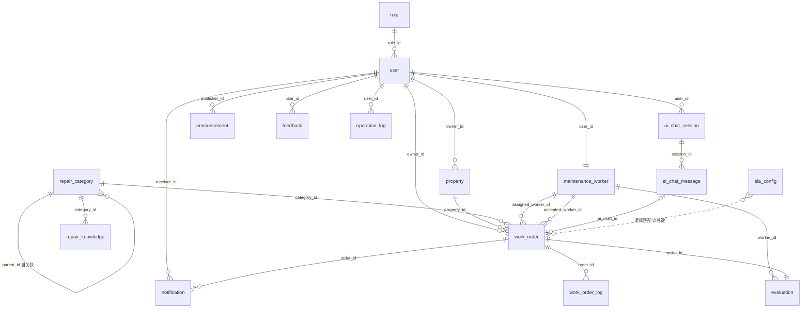

# 基于 Spring Boot 的物业报修系统 — 开发文档总览

> 本文档为毕业设计《基于 Spring Boot 的物业报修系统的设计与实现》的开发文档集索引，包含技术栈、项目结构、配置、数据库、接口、前后端开发规范。
> 目标：开发人员可据此直接开工，无需额外口头沟通。

---

## 一、文档导航

| 文档                     | 内容                                                         |
| ------------------------ | ------------------------------------------------------------ |
| `00-总览与技术栈.md`     | 本文件：项目简介、技术栈版本、项目结构、环境要求             |
| `01-配置类与配置文件.md` | `application.yml` 全量配置、各配置类职责与 Bean 清单         |
| `02-数据库设计.md`       | 16 张表 DDL、字段说明、索引、初始化数据                      |
| `03-接口文档.md`         | 全部 REST 接口：URL、方法、权限、参数、响应、错误码          |
| `04-后端开发文档.md`     | 包结构、分层规范、关键类清单、状态机、Redis/RocketMQ/Spring AI 使用 |
| `05-前端开发文档.md`     | 目录结构、路由、Pinia、API 封装、页面-接口映射、SSE 流式对接 |

---

## 二、项目简介

物业报修系统面向小区物业场景，提供报修、派单、处理、评价的完整闭环，并融入 AI 智能维修助手：业主先用自然语言描述故障，AI 每轮检索维修知识库并提供解决方案；用户反馈已解决才记为自助解决，反馈未解决则继续排查。用户点击生成工单草稿，或在对话中明确说「帮我生成工单」等指令时执行预填写，草稿有效 15 分钟，经用户核对确认后提交正式工单。

### 系统角色

| 角色       | role_code | 说明                                           |
| ---------- | --------- | ---------------------------------------------- |
| 业主       | `OWNER`   | 发起报修、跟踪工单、评价、使用 AI 助手         |
| 维修师傅   | `WORKER`  | 抢单/接单、上门处理、提交完工、查看统计        |
| 物业管理员 | `ADMIN`   | 工单管理、师傅管理、SLA 配置、知识库、统计看板 |

### 核心业务闭环

```
业主对话 → AI 检索知识库并给出解决方案 → 用户点击已解决则结束
              ↑ 未解决：给出其他方案并追问 1～2 个关键问题
                                    ↓ 用户点击或明确说生成工单草稿
                          AI 提取 8 个字段，草稿保存 15 分钟
                                    ↓ 一键确认
                          生成工单 → RocketMQ 事件流
                                    ↓
              派单/抢单 → 到场签到 → 处理 → 完工 → 评价
                                    ↓
                    SLA 超时延迟消息 → 升级告警
```

---

## 三、技术栈与版本

### 后端

| 类别     | 技术                                    | 版本          | 说明                                |
| -------- | --------------------------------------- | ------------- | ----------------------------------- |
| 语言     | JDK                                     | 17 (LTS)      | Spring Boot 3 强制 ≥17              |
| 框架     | Spring Boot                             | 3.5.x         | 需支持 Spring AI                    |
| AI 框架  | Spring AI                               | 1.0.x (GA)    | ChatClient、Tool Calling、RAG       |
| 大模型   | OpenAI 兼容协议                         | —             | DeepSeek / 通义千问 / Qwen          |
| 向量库   | Redis Stack (RediSearch)                | 7.2+          | RAG 检索，与业务 Redis 共用实例     |
| 权限     | Spring Security                         | 6.x           | RBAC + JWT                          |
| Token    | jjwt                                    | 0.12.x        | JWT 生成与校验                      |
| ORM      | MyBatis-Plus                            | 3.5.7+        | `mybatis-plus-spring-boot3-starter` |
| 数据库   | MySQL                                   | 8.0           | 业务数据                            |
| 缓存/锁  | Redis + Redisson                        | 7.x / 3.27+   | 缓存、ZSet、分布式锁                |
| 消息队列 | RocketMQ + rocketmq-spring-boot-starter | 5.5.x / 2.3.1 | 事件流 + 任意时间延迟消息           |
| 对象存储 | MinIO                                   | 8.5.x         | 报修/完工图片                       |
| 接口文档 | Knife4j                                 | 4.5.0         | OpenAPI 3（jakarta）                |
| 工具     | Lombok / Hutool / MapStruct             | —             | 简化代码、字段映射                  |

### 前端

| 类别     | 技术                  | 版本       | 说明            |
| -------- | --------------------- | ---------- | --------------- |
| 框架     | Vue                   | 3.4+       | Composition API |
| 构建     | Vite                  | 5.x        | —               |
| 状态     | Pinia                 | 2.x        | —               |
| 路由     | Vue Router            | 4.x        | 权限路由        |
| UI       | Element Plus          | 2.x        | —               |
| 图表     | ECharts               | 5.x        | 统计看板        |
| HTTP     | Axios                 | 1.x        | 拦截器统一处理  |
| Markdown | marked + highlight.js | —          | AI 回答渲染     |
| 流式     | EventSource (SSE)     | 浏览器原生 | AI 打字机效果   |

---

## 四、项目结构

### 后端结构（Maven 单模块）

```
property-repair-backend
├── pom.xml
├── src/main/java/com/xxx/repair
│   ├── RepairApplication.java            # 启动类
│   ├── common/                           # 通用
│   │   ├── result/                       # 统一响应 Result / PageResult
│   │   ├── exception/                    # 业务异常 + 全局异常处理
│   │   ├── enums/                        # 枚举（工单状态、紧急程度等）
│   │   ├── constant/                     # 常量（Redis Key、MQ Topic）
│   │   └── util/                         # 工具类
│   ├── config/                           # 配置类（见 01 文档）
│   ├── security/                         # Spring Security + JWT
│   ├── controller/                       # REST 接口层
│   ├── service/                          # 业务层
│   │   └── impl/
│   ├── mapper/                           # MyBatis-Plus Mapper
│   ├── entity/                           # 数据库实体
│   ├── dto/                              # 模块内部实体 DTO
│   ├── request/                          # 入参 RequestVO
│   ├── response/                         # 出参 ResponseVO
│   ├── mq/                               # RocketMQ 生产者/消费者
│   ├── ai/                               # Spring AI 相关（Tools、Assistant）
│   └── statemachine/                     # 工单状态机
├── src/main/resources
│   ├── application.yml
│   ├── application-dev.yml
│   ├── application-prod.yml
│   ├── mapper/                           # MyBatis XML（复杂查询）
│   ├── db/                               # 建表 SQL、初始化数据
│   └── prompts/                          # AI 提示词模板
```

### 前端结构（Vite 单页应用）

```
property-repair-frontend
├── package.json
├── vite.config.js
├── .env.development / .env.production
├── src
│   ├── main.js
│   ├── App.vue
│   ├── api/                              # 接口封装（按模块分文件）
│   ├── router/                           # 路由 + 权限守卫
│   ├── stores/                           # Pinia
│   ├── utils/                            # request.js、sse.js、auth.js
│   ├── components/                       # 公共组件
│   ├── views/                            # 页面（按角色分目录）
│   │   ├── auth/                         # 登录注册
│   │   ├── owner/                        # 业主端
│   │   ├── worker/                       # 师傅端
│   │   └── admin/                        # 管理端
│   └── assets/
```

---

## 五、环境要求

| 组件        | 版本  | 说明                                                      |
| ----------- | ----- | --------------------------------------------------------- |
| JDK         | 17    | —                                                         |
| Maven       | 3.8+  | —                                                         |
| Node.js     | 18+   | 前端构建                                                  |
| MySQL       | 8.0   | 端口 3306                                                 |
| Redis Stack | 7.2+  | 端口 6379，**必须 Stack 版**（含 RediSearch，供向量检索） |
| RocketMQ    | 5.5.x | Namesrv 9876，Broker 10911，Proxy 8081                    |
| MinIO       | 最新  | 端口 9000（API）、9001（控制台）                          |

### 本地启动顺序

```
MySQL → Redis Stack → RocketMQ(Namesrv+Broker+Proxy) → MinIO → 后端 → 前端
```

---

## 六、统一约定速览（详见 03/04 文档）

- **统一响应体**：`{ "code": 200, "message": "success", "data": ... }`
- **鉴权**：请求头 `Authorization: Bearer {jwt}`
- **分页**：`pageNum`、`pageSize`；响应含 `total`、`pages`、`records`
- **时间格式**：`yyyy-MM-dd HH:mm:ss`
- **主键策略**：雪花 ID（MyBatis-Plus `ASSIGN_ID`）
- **逻辑删除**：`deleted` 字段（0 正常 / 1 删除）
- **角色权限注解**：`@PreAuthorize("hasRole('OWNER')")`

---

# 配置类与配置文件

> 本文档定义项目全部配置文件与配置类。开发时必须严格对齐 Key 名称与 Bean 名称。

---

## 一、配置文件清单

| 文件                   | 用途                               |
| ---------------------- | ---------------------------------- |
| `application.yml`      | 主配置（公共项 + 激活 profile）    |
| `application-dev.yml`  | 开发环境（本地连接）               |
| `application-prod.yml` | 生产环境（关闭 SQL 打印、Swagger） |

---

## 二、application.yml（主配置）

```yaml
server:
  port: 8080
  servlet:
    context-path: /

spring:
  application:
    name: property-repair
  profiles:
    active: dev
  servlet:
    multipart:
      max-file-size: 10MB
      max-request-size: 50MB
  jackson:
    date-format: yyyy-MM-dd HH:mm:ss
    time-zone: GMT+8
    default-property-inclusion: non_null
  mvc:
    async:
      request-timeout: 60000          # SSE 流式响应超时（毫秒）

# ---------- 数据源 ----------
  datasource:
    driver-class-name: com.mysql.cj.jdbc.Driver
    url: jdbc:mysql://localhost:3306/property_repair?useUnicode=true&characterEncoding=utf8&serverTimezone=Asia/Shanghai&useSSL=false&allowPublicKeyRetrieval=true
    username: root
    password: root
    hikari:
      minimum-idle: 5
      maximum-pool-size: 20
      idle-timeout: 300000
      connection-timeout: 30000

# ---------- Redis（业务 + 向量库） ----------
  data:
    redis:
      host: localhost
      port: 6379
      password:
      database: 0
      timeout: 5000ms
      lettuce:
        pool:
          max-active: 16
          max-idle: 8
          min-idle: 2

# ---------- Spring AI ----------
  ai:
    openai:
      api-key: ${AI_API_KEY:sk-xxxx}          # 环境变量注入，勿硬编码
      base-url: https://api.deepseek.com      # OpenAI 兼容协议
      chat:
        options:
          model: deepseek-chat
          temperature: 0.3
          max-tokens: 2048
      embedding:
        options:
          model: text-embedding-3-small
    vectorstore:
      redis:
        index: repair-knowledge
        prefix: "ai:vector:"
        initialize-schema: true
        vector-dimensions: 1024

# ---------- RocketMQ ----------
rocketmq:
  name-server: localhost:9876
  producer:
    group: repair-producer-group
    send-message-timeout: 3000
    retry-times-when-send-failed: 2

# ---------- MyBatis-Plus ----------
mybatis-plus:
  mapper-locations: classpath*:mapper/**/*.xml
  type-aliases-package: com.xxx.repair.entity
  configuration:
    map-underscore-to-camel-case: true
    log-impl: org.apache.ibatis.logging.stdout.StdOutImpl   # dev 打开，prod 关闭
  global-config:
    db-config:
      id-type: assign_id
      logic-delete-field: deleted
      logic-delete-value: 1
      logic-not-delete-value: 0

# ---------- Knife4j ----------
knife4j:
  enable: true
  openapi:
    title: 物业报修系统 API
    version: 1.0
    group:
      default:
        api-rule: package
        api-rule-resources:
          - com.xxx.repair.controller

# ---------- MinIO ----------
minio:
  endpoint: http://localhost:9000
  access-key: minioadmin
  secret-key: minioadmin
  bucket: repair-images
  public-url: http://localhost:9000   # 图片可访问前缀

# ---------- JWT ----------
jwt:
  secret: ${JWT_SECRET:please-change-this-secret-key-to-a-long-random-string}
  expire: 7200          # 秒（2 小时）
  refresh-expire: 604800 # 秒（7 天）
  header: Authorization
  prefix: "Bearer "

# ---------- Redisson ----------
redisson:
  address: redis://localhost:6379
  database: 1           # 与业务 Redis 隔离库
  lock-wait-time: 0     # 秒，抢单锁立即返回
  lock-lease-time: 10   # 秒，锁自动释放

# ---------- 业务参数 ----------
repair:
  sla:
    default-response-timeout: 120   # 分钟
    default-handle-timeout: 1440    # 分钟
  order:
    auto-confirm-hours: 48          # 完工后自动确认时长
  ai:
    follow-up-limit: 2              # 槽位填充最多追问次数
    hot-question-ttl: 3600          # 热门问答缓存秒数
    session-ttl: 7200               # 会话上下文缓存秒数
```

---

## 三、application-dev.yml

```yaml
spring:
  datasource:
    url: jdbc:mysql://localhost:3306/property_repair?useSSL=false&serverTimezone=Asia/Shanghai
mybatis-plus:
  configuration:
    log-impl: org.apache.ibatis.logging.stdout.StdOutImpl
logging:
  level:
    com.xxx.repair: debug
    org.springframework.ai: debug
```

## 四、application-prod.yml

```yaml
spring:
  ai:
    openai:
      api-key: ${AI_API_KEY}
mybatis-plus:
  configuration:
    log-impl: org.apache.ibatis.logging.nologging.NoLoggingImpl
knife4j:
  enable: false
logging:
  level:
    com.xxx.repair: info
```

---

## 五、配置类清单与职责

| 配置类                   | 位置               | 作用                                           |
| ------------------------ | ------------------ | ---------------------------------------------- |
| `MybatisPlusConfig`      | `config`           | 分页插件、乐观锁插件、字段自动填充             |
| `RedisConfig`            | `config`           | RedisTemplate 序列化、缓存 Key 前缀            |
| `RedissonConfig`         | `config`           | 分布式锁客户端                                 |
| `RocketMQConfig`         | `config`           | 生产者分组、发送超时、消费者并发               |
| `SpringAiConfig`         | `ai`               | ChatClient、VectorStore、Tools 注册            |
| `MinioConfig`            | `config`           | MinIO 客户端、Bucket 初始化                    |
| `SecurityConfig`         | `security`         | 安全过滤链、放行白名单、密码编码器             |
| `WebMvcConfig`           | `config`           | 跨域、静态资源、参数解析器、拦截器注册         |
| `JacksonConfig`          | `config`           | 时间格式、Long 转 String（防精度丢失）         |
| `Knife4jConfig`          | `config`           | OpenAPI 文档、JWT 全局鉴权按钮                 |
| `AsyncConfig`            | `config`           | 异步线程池（AI 任务、通知）                    |
| `SseConfig`              | `config`           | SSE 流式响应线程池与超时                       |
| `GlobalExceptionHandler` | `common.exception` | 全局异常 → 统一响应                            |
| `MetaObjectHandlerImpl`  | `config`           | `create_time`/`update_time`/`deleted` 自动填充 |

---

## 六、各配置类详细说明

### 6.1 MybatisPlusConfig

| Bean                     | 类型                     | 说明                                                         |
| ------------------------ | ------------------------ | ------------------------------------------------------------ |
| `mybatisPlusInterceptor` | `MybatisPlusInterceptor` | 注册 `PaginationInnerInterceptor`(MySQL) + `OptimisticLockerInnerInterceptor` |

要点：

- 分页插件必须选 `DbType.MYSQL`
- 乐观锁用于 `work_order` 的 `version` 字段（防并发改状态覆盖）

### 6.2 RedisConfig

| Bean                  | 类型                           | 说明                                   |
| --------------------- | ------------------------------ | -------------------------------------- |
| `redisTemplate`       | `RedisTemplate<String,Object>` | Key 用 String 序列化，Value 用 Jackson |
| `stringRedisTemplate` | `StringRedisTemplate`          | 计数、幂等、简单 KV                    |

要点：

- Value 序列化用 `GenericJackson2JsonRedisSerializer`，保留类型信息
- 注册 `RedisTemplate` 时必须 `afterPropertiesSet()`

### 6.3 RedissonConfig

| Bean             | 类型             | 说明                         |
| ---------------- | ---------------- | ---------------------------- |
| `redissonClient` | `RedissonClient` | 单机模式，`redisson.address` |

要点：抢单锁 `RLock` 由 `RedissonClient.getLock("lock:workorder:grab:{orderId}")` 获取。

### 6.4 RocketMQConfig

| 项         | 说明                                                         |
| ---------- | ------------------------------------------------------------ |
| 生产者组   | `repair-producer-group`                                      |
| 消费者并发 | 每个 `@RocketMQMessageListener` 默认 `consumeThreadMax=20`   |
| 延迟消息   | 使用 `syncSend(topic:tag, msg, timeout, delaySeconds)` 传任意延迟秒数（RocketMQ 5.x 原生） |
| 顺序消息   | 工单事件流按 `orderId` 哈希选择队列，`@RocketMQMessageListener(consumeMode = ORDERLY)` |

### 6.5 SpringAiConfig（核心）

| Bean          | 类型               | 说明                            |
| ------------- | ------------------ | ------------------------------- |
| `chatClient`  | `ChatClient`       | 默认 System Prompt + 注册 Tools |
| `vectorStore` | `RedisVectorStore` | 维修知识向量库                  |
| `chatMemory`  | `ChatMemory`       | 会话记忆（基于 Redis）          |

要点：

- `chatClient` 注入 `RepairAssistantTools`（查询工单、查在线师傅、查知识库）
- `vectorStore` 索引名 `repair-knowledge`，维度与 embedding 模型一致（1024）
- Prompt 模板存放于 `resources/prompts/assistant-system.txt`

### 6.6 MinioConfig

| Bean          | 类型                                                    | 说明   |
| ------------- | ------------------------------------------------------- | ------ |
| `minioClient` | `MinioClient`                                           | 客户端 |
| Bucket 初始化 | 启动时校验 `repair-images` 存在，不存在则创建并设公开读 |        |

### 6.7 SecurityConfig

| 项         | 值                                                           |
| ---------- | ------------------------------------------------------------ |
| 放行白名单 | `/api/auth/**`、`/doc.html`、`/webjars/**`、`/v3/api-docs/**`、`/swagger-resources/**`、`/api/file/public/**` |
| 密码编码   | `BCryptPasswordEncoder`                                      |
| 会话策略   | `STATELESS`                                                  |
| 过滤器     | `JwtAuthenticationFilter`（在 `UsernamePasswordAuthenticationFilter` 前） |
| 方法级鉴权 | 开启 `@EnableMethodSecurity`                                 |
| 跨域       | 交由 `WebMvcConfig`，Security 内 `cors(Customizer.withDefaults())` |

### 6.8 WebMvcConfig

| 项         | 说明                                                         |
| ---------- | ------------------------------------------------------------ |
| CORS       | 允许前端域名，`allowCredentials=true`，暴露 `Authorization` 头 |
| 拦截器     | `AuthInterceptor` 解析用户上下文（UserIdHolder）             |
| 消息转换器 | 字符串消息用 `StringHttpMessageConverter`，避免中文乱码      |

### 6.9 JacksonConfig

| 项            | 说明                                         |
| ------------- | -------------------------------------------- |
| Long → String | 用 `ToStringSerializer` 防止雪花 ID 精度丢失 |
| 时间          | `LocalDateTime` 用 `yyyy-MM-dd HH:mm:ss`     |
| 空值          | 不输出 null 字段                             |

### 6.10 Knife4jConfig

| 项   | 说明                                                      |
| ---- | --------------------------------------------------------- |
| 分组 | 按 controller 包分组                                      |
| 鉴权 | 全局 `SecurityScheme` 为 `bearerAuth`，文档页可输入 Token |
| 说明 | 每个接口用 `@Operation`、`@Tag` 标注中文说明              |

### 6.11 AsyncConfig

| Bean           | 说明                                             |
| -------------- | ------------------------------------------------ |
| `taskExecutor` | 核心 8 / 最大 16 / 队列 200，线程名前缀 `async-` |
| 用途           | AI 异步任务、通知发送、日志落库解耦              |

### 6.12 SseConfig

| 项              | 说明                                                |
| --------------- | --------------------------------------------------- |
| 超时            | 120 秒，需覆盖 AI 首 Token 与工单草稿结构化抽取时间 |
| 线程池          | 流式响应独立线程池，避免占用 Web 线程               |
| Controller 返回 | `SseEmitter` 或 `Flux<ServerSentEvent<String>>`     |

### 6.13 GlobalExceptionHandler

| 异常                              | 响应 code | 说明                              |
| --------------------------------- | --------- | --------------------------------- |
| `BizException`                    | 自定义    | 业务异常，返回 `code` + `message` |
| `MethodArgumentNotValidException` | 400       | 参数校验失败，返回首个失败字段    |
| `AccessDeniedException`           | 403       | 无权限                            |
| `AuthenticationException`         | 401       | 未登录/Token 失效                 |
| `MaxUploadSizeExceededException`  | 413       | 上传文件过大                      |
| `Exception`                       | 500       | 兜底，记录日志，返回通用提示      |

### 6.14 MetaObjectHandlerImpl

| 时机         | 填充字段                                             |
| ------------ | ---------------------------------------------------- |
| `insertFill` | `createTime`、`updateTime`、`deleted=0`、`version=0` |
| `updateFill` | `updateTime`                                         |

---

## 七、环境变量清单（部署必配）

| 变量                     | 说明                     | 示例        |
| ------------------------ | ------------------------ | ----------- |
| `AI_API_KEY`             | 大模型 API Key           | `sk-xxxxxx` |
| `JWT_SECRET`             | JWT 签名密钥（≥32 字符） | 随机字符串  |
| `SPRING_PROFILES_ACTIVE` | 激活环境                 | `prod`      |

> 安全要求：密钥严禁写入代码或提交到 Git，一律走环境变量。

---

# 数据库设计

> 数据库：MySQL 8.0，字符集 `utf8mb4`，引擎 InnoDB。
> 共 **16 张表**：业务表 13 张 + AI 表 3 张。
> 通用字段：`create_time`、`update_time`、`deleted`（逻辑删除）。主键统一 `BIGINT`（雪花 ID）。

---

## 一、表清单

| #    | 表名                 | 说明                 | 类型 |
| ---- | -------------------- | -------------------- | ---- |
| 1    | `user`               | 用户表（三角色共用） | 业务 |
| 2    | `role`               | 角色表               | 业务 |
| 3    | `property`           | 房产表               | 业务 |
| 4    | `work_order`         | 工单表（核心）       | 业务 |
| 5    | `work_order_log`     | 工单流转日志表       | 业务 |
| 6    | `maintenance_worker` | 维修师傅扩展表       | 业务 |
| 7    | `repair_category`    | 报修类型表（树形）   | 业务 |
| 8    | `evaluation`         | 评价表               | 业务 |
| 9    | `sla_config`         | SLA 配置表           | 业务 |
| 10   | `announcement`       | 公告表               | 业务 |
| 11   | `feedback`           | 问题反馈表           | 业务 |
| 12   | `operation_log`      | 操作日志表           | 业务 |
| 13   | `notification`       | 站内通知表           | 业务 |
| 14   | `ai_chat_session`    | AI 会话表            | AI   |
| 15   | `ai_chat_message`    | AI 消息表            | AI   |
| 16   | `repair_knowledge`   | 维修知识库表         | AI   |

> 说明：用户与角色为**一对多直连**（`user.role_id`），不设中间表，保持 13 张业务表口径。

---

## 二、建表 DDL

### 2.1 role 角色表

```sql
CREATE TABLE `role` (
  `id`          BIGINT       NOT NULL COMMENT '主键',
  `role_code`   VARCHAR(20)  NOT NULL COMMENT '角色编码：OWNER/WORKER/ADMIN',
  `role_name`   VARCHAR(50)  NOT NULL COMMENT '角色名称',
  `description` VARCHAR(255)          DEFAULT NULL COMMENT '描述',
  `create_time` DATETIME     NOT NULL DEFAULT CURRENT_TIMESTAMP,
  `update_time` DATETIME     NOT NULL DEFAULT CURRENT_TIMESTAMP ON UPDATE CURRENT_TIMESTAMP,
  `deleted`     TINYINT      NOT NULL DEFAULT 0 COMMENT '0正常 1删除',
  PRIMARY KEY (`id`),
  UNIQUE KEY `uk_role_code` (`role_code`)
) ENGINE=InnoDB DEFAULT CHARSET=utf8mb4 COMMENT='角色表';
```

初始化数据：`OWNER 业主`、`WORKER 维修师傅`、`ADMIN 物业管理员`。

### 2.2 user 用户表

```sql
CREATE TABLE `user` (
  `id`              BIGINT       NOT NULL COMMENT '主键',
  `username`        VARCHAR(50)  NOT NULL COMMENT '登录名',
  `password`        VARCHAR(100) NOT NULL COMMENT 'BCrypt 密码',
  `real_name`       VARCHAR(50)           DEFAULT NULL COMMENT '真实姓名',
  `phone`           VARCHAR(20)  NOT NULL COMMENT '手机号',
  `email`           VARCHAR(100)          DEFAULT NULL COMMENT '邮箱',
  `avatar`          VARCHAR(255)          DEFAULT NULL COMMENT '头像 URL',
  `gender`          TINYINT      NOT NULL DEFAULT 0 COMMENT '0未知 1男 2女',
  `role_id`         BIGINT       NOT NULL COMMENT '角色ID',
  `status`          TINYINT      NOT NULL DEFAULT 1 COMMENT '0禁用 1正常',
  `last_login_time` DATETIME              DEFAULT NULL COMMENT '最近登录时间',
  `create_time`     DATETIME     NOT NULL DEFAULT CURRENT_TIMESTAMP,
  `update_time`     DATETIME     NOT NULL DEFAULT CURRENT_TIMESTAMP ON UPDATE CURRENT_TIMESTAMP,
  `deleted`         TINYINT      NOT NULL DEFAULT 0,
  PRIMARY KEY (`id`),
  UNIQUE KEY `uk_username` (`username`),
  UNIQUE KEY `uk_phone` (`phone`),
  KEY `idx_role_id` (`role_id`),
  KEY `idx_status` (`status`)
) ENGINE=InnoDB DEFAULT CHARSET=utf8mb4 COMMENT='用户表';
```

### 2.3 property 房产表

```sql
CREATE TABLE `property` (
  `id`           BIGINT       NOT NULL,
  `owner_id`     BIGINT       NOT NULL COMMENT '业主 user_id',
  `community`    VARCHAR(100) NOT NULL COMMENT '小区',
  `building`     VARCHAR(20)  NOT NULL COMMENT '栋',
  `unit`         VARCHAR(20)  NOT NULL COMMENT '单元',
  `room`         VARCHAR(20)  NOT NULL COMMENT '房号',
  `full_address` VARCHAR(255) NOT NULL COMMENT '完整地址',
  `area_size`    DECIMAL(10,2)         DEFAULT NULL COMMENT '面积(㎡)',
  `is_default`   TINYINT      NOT NULL DEFAULT 0 COMMENT '0否 1默认',
  `status`       TINYINT      NOT NULL DEFAULT 1 COMMENT '0禁用 1正常',
  `create_time`  DATETIME     NOT NULL DEFAULT CURRENT_TIMESTAMP,
  `update_time`  DATETIME     NOT NULL DEFAULT CURRENT_TIMESTAMP ON UPDATE CURRENT_TIMESTAMP,
  `deleted`      TINYINT      NOT NULL DEFAULT 0,
  PRIMARY KEY (`id`),
  KEY `idx_owner_id` (`owner_id`),
  UNIQUE KEY `uk_address` (`community`,`building`,`unit`,`room`)
) ENGINE=InnoDB DEFAULT CHARSET=utf8mb4 COMMENT='房产表';
```

### 2.4 repair_category 报修类型表

```sql
CREATE TABLE `repair_category` (
  `id`          BIGINT       NOT NULL,
  `name`        VARCHAR(50)  NOT NULL COMMENT '类型名称',
  `parent_id`   BIGINT       NOT NULL DEFAULT 0 COMMENT '父类型ID，0为一级',
  `sort`        INT          NOT NULL DEFAULT 0 COMMENT '排序',
  `icon`        VARCHAR(255)          DEFAULT NULL COMMENT '图标 URL',
  `status`      TINYINT      NOT NULL DEFAULT 1 COMMENT '0禁用 1正常',
  `create_time` DATETIME     NOT NULL DEFAULT CURRENT_TIMESTAMP,
  `update_time` DATETIME     NOT NULL DEFAULT CURRENT_TIMESTAMP ON UPDATE CURRENT_TIMESTAMP,
  `deleted`     TINYINT      NOT NULL DEFAULT 0,
  PRIMARY KEY (`id`),
  KEY `idx_parent_id` (`parent_id`)
) ENGINE=InnoDB DEFAULT CHARSET=utf8mb4 COMMENT='报修类型表';
```

示例数据：水管维修（水龙头/马桶/下水道）、电器维修（空调/热水器/照明）、门窗维修、公共设施…

### 2.5 maintenance_worker 维修师傅扩展表

```sql
CREATE TABLE `maintenance_worker` (
  `id`            BIGINT       NOT NULL,
  `user_id`       BIGINT       NOT NULL COMMENT '关联 user.id',
  `worker_no`     VARCHAR(50)  NOT NULL COMMENT '工号',
  `skill_tags`    VARCHAR(255)          DEFAULT NULL COMMENT '技能标签，逗号分隔',
  `id_card`       VARCHAR(20)           DEFAULT NULL COMMENT '身份证号',
  `work_status`   TINYINT      NOT NULL DEFAULT 0 COMMENT '0审核中 1在线 2离线 3忙碌 4禁用',
  `audit_status`  TINYINT      NOT NULL DEFAULT 0 COMMENT '0待审 1通过 2驳回',
  `audit_remark`  VARCHAR(255)          DEFAULT NULL COMMENT '审核备注',
  `total_orders`  INT          NOT NULL DEFAULT 0 COMMENT '累计接单量',
  `finish_orders` INT          NOT NULL DEFAULT 0 COMMENT '累计完成量',
  `avg_score`     DECIMAL(3,1) NOT NULL DEFAULT 0.0 COMMENT '平均评分',
  `current_load`  INT          NOT NULL DEFAULT 0 COMMENT '当前进行中工单数',
  `create_time`   DATETIME     NOT NULL DEFAULT CURRENT_TIMESTAMP,
  `update_time`   DATETIME     NOT NULL DEFAULT CURRENT_TIMESTAMP ON UPDATE CURRENT_TIMESTAMP,
  `deleted`       TINYINT      NOT NULL DEFAULT 0,
  PRIMARY KEY (`id`),
  UNIQUE KEY `uk_user_id` (`user_id`),
  UNIQUE KEY `uk_worker_no` (`worker_no`),
  KEY `idx_audit_status` (`audit_status`),
  KEY `idx_work_status` (`work_status`)
) ENGINE=InnoDB DEFAULT CHARSET=utf8mb4 COMMENT='维修师傅扩展表';
```

### 2.6 work_order 工单表（核心）

```sql
CREATE TABLE `work_order` (
  `id`                  BIGINT       NOT NULL,
  `order_no`            VARCHAR(32)  NOT NULL COMMENT '工单号',
  `property_id`         BIGINT       NOT NULL COMMENT '报修房产ID',
  `owner_id`            BIGINT       NOT NULL COMMENT '业主 user_id',
  `category_id`         BIGINT       NOT NULL COMMENT '报修类型ID（二级）',
  `title`               VARCHAR(100) NOT NULL COMMENT '工单标题',
  `description`         TEXT                  COMMENT '故障现象描述',

  -- ===== AI 可提取字段（新增） =====
  `fault_duration`      VARCHAR(50)           DEFAULT NULL COMMENT '故障持续时间，如"约1天"',
  `affect_scope`        TINYINT      NOT NULL DEFAULT 1 COMMENT '影响范围：1本户 2本层 3整栋',
  `safety_flag`         VARCHAR(50)           DEFAULT NULL COMMENT '安全隐患标志：涉电/涉水/涉气/高空，逗号分隔',
  `device_info`         VARCHAR(100)          DEFAULT NULL COMMENT '设备品牌型号',
  -- ===== 用户确认字段（新增） =====
  `expected_visit_time` VARCHAR(50)           DEFAULT NULL COMMENT '期望上门时段，如"今天下午"',
  `contact_phone`       VARCHAR(20)           DEFAULT NULL COMMENT '联系人电话',
  -- ===== 原有字段 =====
  `urgency`             TINYINT      NOT NULL DEFAULT 2 COMMENT '紧急程度：1低 2中 3高 4紧急',
  `images`              VARCHAR(1000)         DEFAULT NULL COMMENT '图片URL，逗号分隔',
  `status`              VARCHAR(20)  NOT NULL COMMENT '状态枚举，见状态机',
  `source`              VARCHAR(20)  NOT NULL DEFAULT 'MANUAL' COMMENT '来源：MANUAL手填 AI智能助手',

  `assigned_worker_id`  BIGINT                DEFAULT NULL COMMENT '派单给谁(worker.id)',
  `accepted_worker_id`  BIGINT                DEFAULT NULL COMMENT '实际接单(worker.id)',
  `assigned_time`       DATETIME              DEFAULT NULL COMMENT '派单时间',
  `accepted_time`       DATETIME              DEFAULT NULL COMMENT '接单时间',
  `arrived_time`        DATETIME              DEFAULT NULL COMMENT '到场时间',
  `submitted_time`      DATETIME              DEFAULT NULL COMMENT '完工提交时间',
  `completed_time`      DATETIME              DEFAULT NULL COMMENT '完工确认时间',
  `closed_time`         DATETIME              DEFAULT NULL COMMENT '关闭时间',
  `cancel_reason`       VARCHAR(255)          DEFAULT NULL COMMENT '取消原因',
  `transfer_reason`     VARCHAR(255)          DEFAULT NULL COMMENT '转单原因',
  `process_note`        TEXT                  COMMENT '处理过程记录',
  `finish_images`       VARCHAR(1000)         DEFAULT NULL COMMENT '完工照片URL，逗号分隔',

  `sla_response_deadline` DATETIME            DEFAULT NULL COMMENT '响应超时点',
  `sla_handle_deadline`   DATETIME            DEFAULT NULL COMMENT '处理超时点',
  `sla_escalated`         TINYINT      NOT NULL DEFAULT 0 COMMENT '0未升级 1已升级',
  `sla_response_breached` TINYINT      NOT NULL DEFAULT 0 COMMENT '响应是否超时',
  `sla_handle_breached`   TINYINT      NOT NULL DEFAULT 0 COMMENT '处理是否超时',

  `ai_draft_id`         BIGINT                DEFAULT NULL COMMENT '来源 AI 草稿ID(ai_chat_message.id)',
  `version`             INT          NOT NULL DEFAULT 0 COMMENT '乐观锁版本',
  `create_time`         DATETIME     NOT NULL DEFAULT CURRENT_TIMESTAMP,
  `update_time`         DATETIME     NOT NULL DEFAULT CURRENT_TIMESTAMP ON UPDATE CURRENT_TIMESTAMP,
  `deleted`             TINYINT      NOT NULL DEFAULT 0,
  PRIMARY KEY (`id`),
  UNIQUE KEY `uk_order_no` (`order_no`),
  KEY `idx_owner_id` (`owner_id`),
  KEY `idx_property_id` (`property_id`),
  KEY `idx_accepted_worker_id` (`accepted_worker_id`),
  KEY `idx_status` (`status`),
  KEY `idx_urgency` (`urgency`),
  KEY `idx_create_time` (`create_time`),
  KEY `idx_sla_escalated` (`sla_escalated`)
) ENGINE=InnoDB DEFAULT CHARSET=utf8mb4 COMMENT='工单表';
```

### 2.7 work_order_log 工单流转日志表

```sql
CREATE TABLE `work_order_log` (
  `id`            BIGINT       NOT NULL,
  `order_id`      BIGINT       NOT NULL COMMENT '工单ID',
  `operator_id`   BIGINT                DEFAULT NULL COMMENT '操作人ID',
  `operator_type` VARCHAR(20)           DEFAULT NULL COMMENT 'OWNER/WORKER/ADMIN/SYSTEM',
  `action`        VARCHAR(50)  NOT NULL COMMENT 'CREATE/ASSIGN/ACCEPT/ARRIVE/PAUSE/RESUME/TRANSFER/SYSTEM_SUBMIT/COMPLETE/CANCEL',
  `from_status`   VARCHAR(20)           DEFAULT NULL COMMENT '原状态',
  `to_status`     VARCHAR(20)           DEFAULT NULL COMMENT '新状态',
  `remark`        VARCHAR(500)          DEFAULT NULL COMMENT '备注',
  `create_time`   DATETIME     NOT NULL DEFAULT CURRENT_TIMESTAMP,
  `update_time`   DATETIME     NOT NULL DEFAULT CURRENT_TIMESTAMP ON UPDATE CURRENT_TIMESTAMP,
  `deleted`       TINYINT      NOT NULL DEFAULT 0,
  PRIMARY KEY (`id`),
  KEY `idx_order_id` (`order_id`),
  KEY `idx_operator_id` (`operator_id`),
  KEY `idx_create_time` (`create_time`)
) ENGINE=InnoDB DEFAULT CHARSET=utf8mb4 COMMENT='工单流转日志表';
```

### 2.8 evaluation 评价表

```sql
CREATE TABLE `evaluation` (
  `id`             BIGINT      NOT NULL,
  `order_id`       BIGINT      NOT NULL COMMENT '工单ID',
  `owner_id`       BIGINT      NOT NULL COMMENT '业主ID',
  `worker_id`      BIGINT      NOT NULL COMMENT '师傅ID(worker.id)',
  `score`          TINYINT     NOT NULL COMMENT '总分 1-5',
  `speed_score`    TINYINT              DEFAULT NULL COMMENT '响应速度分',
  `attitude_score` TINYINT              DEFAULT NULL COMMENT '服务态度分',
  `quality_score`  TINYINT              DEFAULT NULL COMMENT '维修质量分',
  `content`        TEXT                 COMMENT '评价内容',
  `images`         VARCHAR(1000)        DEFAULT NULL COMMENT '评价图片',
  `create_time`    DATETIME    NOT NULL DEFAULT CURRENT_TIMESTAMP,
  `update_time`    DATETIME    NOT NULL DEFAULT CURRENT_TIMESTAMP ON UPDATE CURRENT_TIMESTAMP,
  `deleted`        TINYINT     NOT NULL DEFAULT 0,
  PRIMARY KEY (`id`),
  UNIQUE KEY `uk_order_id` (`order_id`),
  KEY `idx_worker_id` (`worker_id`)
) ENGINE=InnoDB DEFAULT CHARSET=utf8mb4 COMMENT='评价表';
```

### 2.9 sla_config SLA 配置表

```sql
CREATE TABLE `sla_config` (
  `id`               BIGINT      NOT NULL,
  `category_id`      BIGINT               DEFAULT NULL COMMENT '报修类型ID，NULL=全局',
  `urgency`          TINYINT              DEFAULT NULL COMMENT '紧急程度，NULL=所有',
  `safety_flag`      VARCHAR(50)          DEFAULT NULL COMMENT '安全隐患标志，NULL=所有',
  `affect_scope`     TINYINT              DEFAULT NULL COMMENT '影响范围，NULL=所有',
  `response_timeout` INT         NOT NULL COMMENT '响应超时(分钟)',
  `handle_timeout`   INT         NOT NULL COMMENT '处理超时(分钟)',
  `escalate_to`      VARCHAR(50)          DEFAULT NULL COMMENT '升级通知角色：ADMIN',
  `priority_weight`  INT         NOT NULL DEFAULT 0 COMMENT '派单优先级权重',
  `enabled`          TINYINT     NOT NULL DEFAULT 1 COMMENT '0禁用 1启用',
  `create_time`      DATETIME    NOT NULL DEFAULT CURRENT_TIMESTAMP,
  `update_time`      DATETIME    NOT NULL DEFAULT CURRENT_TIMESTAMP ON UPDATE CURRENT_TIMESTAMP,
  `deleted`          TINYINT     NOT NULL DEFAULT 0,
  PRIMARY KEY (`id`),
  KEY `idx_category_urgency` (`category_id`,`urgency`)
) ENGINE=InnoDB DEFAULT CHARSET=utf8mb4 COMMENT='SLA配置表';
```

> **AI 闭环关键**：`safety_flag` + `urgency` + `affect_scope` 由 AI 提取后，参与本表匹配，决定 SLA 阈值与派单优先级。

### 2.10 announcement 公告表

```sql
CREATE TABLE `announcement` (
  `id`           BIGINT       NOT NULL,
  `title`        VARCHAR(200) NOT NULL,
  `content`      TEXT         NOT NULL,
  `type`         VARCHAR(20)  NOT NULL DEFAULT 'SYSTEM' COMMENT 'SYSTEM/MAINTENANCE/ACTIVITY',
  `target_role`  VARCHAR(20)  NOT NULL DEFAULT 'ALL' COMMENT 'ALL/OWNER/WORKER',
  `publisher_id` BIGINT       NOT NULL,
  `publish_time` DATETIME              DEFAULT NULL COMMENT '发布时间',
  `is_top`       TINYINT      NOT NULL DEFAULT 0 COMMENT '0否 1置顶',
  `status`       TINYINT      NOT NULL DEFAULT 0 COMMENT '0草稿 1已发布',
  `view_count`   INT          NOT NULL DEFAULT 0,
  `create_time`  DATETIME     NOT NULL DEFAULT CURRENT_TIMESTAMP,
  `update_time`  DATETIME     NOT NULL DEFAULT CURRENT_TIMESTAMP ON UPDATE CURRENT_TIMESTAMP,
  `deleted`      TINYINT      NOT NULL DEFAULT 0,
  PRIMARY KEY (`id`),
  KEY `idx_status` (`status`),
  KEY `idx_publish_time` (`publish_time`)
) ENGINE=InnoDB DEFAULT CHARSET=utf8mb4 COMMENT='公告表';
```

### 2.11 feedback 问题反馈表

```sql
CREATE TABLE `feedback` (
  `id`          BIGINT       NOT NULL,
  `user_id`     BIGINT       NOT NULL COMMENT '提交人',
  `user_role`   VARCHAR(20)  NOT NULL COMMENT '提交人角色',
  `type`        VARCHAR(20)  NOT NULL DEFAULT 'SUGGESTION' COMMENT 'BUG/SUGGESTION/COMPLAINT',
  `title`       VARCHAR(200) NOT NULL,
  `content`     TEXT         NOT NULL,
  `contact`     VARCHAR(100)          DEFAULT NULL,
  `status`      TINYINT      NOT NULL DEFAULT 0 COMMENT '0待处理 1处理中 2已处理 3关闭',
  `reply`       TEXT                  COMMENT '管理员回复',
  `replier_id`  BIGINT                DEFAULT NULL,
  `reply_time`  DATETIME              DEFAULT NULL,
  `create_time` DATETIME     NOT NULL DEFAULT CURRENT_TIMESTAMP,
  `update_time` DATETIME     NOT NULL DEFAULT CURRENT_TIMESTAMP ON UPDATE CURRENT_TIMESTAMP,
  `deleted`     TINYINT      NOT NULL DEFAULT 0,
  PRIMARY KEY (`id`),
  KEY `idx_user_id` (`user_id`),
  KEY `idx_status` (`status`)
) ENGINE=InnoDB DEFAULT CHARSET=utf8mb4 COMMENT='问题反馈表';
```

### 2.12 operation_log 操作日志表

```sql
CREATE TABLE `operation_log` (
  `id`          BIGINT       NOT NULL,
  `user_id`     BIGINT                DEFAULT NULL,
  `username`    VARCHAR(50)           DEFAULT NULL,
  `role`        VARCHAR(20)           DEFAULT NULL,
  `module`      VARCHAR(50)           DEFAULT NULL COMMENT '模块',
  `action`      VARCHAR(50)           DEFAULT NULL COMMENT '操作',
  `method`      VARCHAR(10)           DEFAULT NULL COMMENT 'HTTP方法',
  `url`         VARCHAR(255)          DEFAULT NULL,
  `params`      TEXT                  COMMENT '请求参数',
  `ip`          VARCHAR(50)           DEFAULT NULL,
  `result`      TINYINT      NOT NULL DEFAULT 1 COMMENT '0失败 1成功',
  `error_msg`   TEXT                  COMMENT '错误信息',
  `cost_time`   INT                   DEFAULT NULL COMMENT '耗时(ms)',
  `create_time` DATETIME     NOT NULL DEFAULT CURRENT_TIMESTAMP,
  `update_time` DATETIME     NOT NULL DEFAULT CURRENT_TIMESTAMP ON UPDATE CURRENT_TIMESTAMP,
  `deleted`     TINYINT      NOT NULL DEFAULT 0,
  PRIMARY KEY (`id`),
  KEY `idx_user_id` (`user_id`),
  KEY `idx_module` (`module`),
  KEY `idx_create_time` (`create_time`)
) ENGINE=InnoDB DEFAULT CHARSET=utf8mb4 COMMENT='操作日志表';
```

### 2.13 notification 站内通知表

```sql
CREATE TABLE `notification` (
  `id`            BIGINT       NOT NULL,
  `event_id`      VARCHAR(160) NOT NULL COMMENT 'MQ事件幂等标识',
  `receiver_id`   BIGINT       NOT NULL COMMENT '接收人user.id',
  `receiver_type` VARCHAR(20)  NOT NULL COMMENT 'OWNER/WORKER/ADMIN',
  `title`         VARCHAR(100) NOT NULL COMMENT '消息标题',
  `content`       TEXT         NOT NULL COMMENT '消息正文',
  `order_id`      BIGINT                DEFAULT NULL COMMENT '关联工单ID',
  `is_read`       TINYINT      NOT NULL DEFAULT 0 COMMENT '0未读 1已读',
  `read_time`     DATETIME              DEFAULT NULL COMMENT '阅读时间',
  `create_time`   DATETIME     NOT NULL DEFAULT CURRENT_TIMESTAMP,
  `update_time`   DATETIME     NOT NULL DEFAULT CURRENT_TIMESTAMP ON UPDATE CURRENT_TIMESTAMP,
  `deleted`       TINYINT      NOT NULL DEFAULT 0,
  PRIMARY KEY (`id`),
  UNIQUE KEY `uk_event_id` (`event_id`),
  KEY `idx_receiver_read_time` (`receiver_id`,`is_read`,`create_time`),
  KEY `idx_order_id` (`order_id`)
) ENGINE=InnoDB DEFAULT CHARSET=utf8mb4 COMMENT='站内通知表';
```

> `event_id` 由原始业务事件 ID、接收人 ID 和 SITE 通道共同派生；MQ 重投时依靠唯一索引幂等。用户侧查询与已读更新必须同时限定当前登录用户的 `receiver_id`。

### 2.14 ai_chat_session AI 会话表

```sql
CREATE TABLE `ai_chat_session` (
  `id`            BIGINT      NOT NULL,
  `user_id`       BIGINT      NOT NULL COMMENT '业主 user_id',
  `title`         VARCHAR(100)         DEFAULT NULL COMMENT '会话标题（取首条消息摘要）',
  `message_count` INT         NOT NULL DEFAULT 0 COMMENT '消息数',
  `resolved`      TINYINT     NOT NULL DEFAULT 0 COMMENT '0进行中 1自助解决 2转工单',
  `create_time`   DATETIME    NOT NULL DEFAULT CURRENT_TIMESTAMP,
  `update_time`   DATETIME    NOT NULL DEFAULT CURRENT_TIMESTAMP ON UPDATE CURRENT_TIMESTAMP,
  `deleted`       TINYINT     NOT NULL DEFAULT 0,
  PRIMARY KEY (`id`),
  KEY `idx_user_id` (`user_id`),
  KEY `idx_create_time` (`create_time`)
) ENGINE=InnoDB DEFAULT CHARSET=utf8mb4 COMMENT='AI会话表';
```

### 2.15 ai_chat_message AI 消息表

```sql
CREATE TABLE `ai_chat_message` (
  `id`             BIGINT      NOT NULL,
  `session_id`     BIGINT      NOT NULL COMMENT '会话ID',
  `sender`         VARCHAR(10) NOT NULL COMMENT 'USER / AI',
  `content`        TEXT                 COMMENT '消息内容(Markdown)',
  `intent`         VARCHAR(20)          DEFAULT NULL COMMENT 'QA问答 / TROUBLESHOOT排查 / FILL_FORM收集信息',
  `citations`      VARCHAR(500)         DEFAULT NULL COMMENT '引用的知识库ID',
  `form_draft`     JSON                 DEFAULT NULL COMMENT '工单草稿(JSON)，仅收集信息阶段',
  `filled_slots`   VARCHAR(500)         DEFAULT NULL COMMENT '已填充槽位名，逗号分隔',
  `missing_slots`  VARCHAR(500)         DEFAULT NULL COMMENT '缺失槽位名，逗号分隔',
  `prompt_tokens`  INT                  DEFAULT NULL,
  `completion_tokens` INT               DEFAULT NULL,
  `cost_ms`        INT                  DEFAULT NULL COMMENT '耗时(ms)',
  `create_time`    DATETIME    NOT NULL DEFAULT CURRENT_TIMESTAMP,
  `update_time`    DATETIME    NOT NULL DEFAULT CURRENT_TIMESTAMP ON UPDATE CURRENT_TIMESTAMP,
  `deleted`        TINYINT     NOT NULL DEFAULT 0,
  PRIMARY KEY (`id`),
  KEY `idx_session_id` (`session_id`),
  KEY `idx_create_time` (`create_time`)
) ENGINE=InnoDB DEFAULT CHARSET=utf8mb4 COMMENT='AI消息表';
```

> `form_draft` 仅在用户点击生成工单草稿，或在对话中明确发出生成工单指令后写入，一键确认时做「草稿 → work_order」转换。有效期为承载草稿消息的 `create_time + 15 分钟`，无需新增表或字段；过期 JSON 仅留作历史记录，不可读取为有效草稿或提交。会话 `resolved=0` 表示排查中、未反馈或仅生成草稿；只有用户点击已解决才置为 1，正式工单提交成功才置为 2。

### 2.16 repair_knowledge 维修知识库表

```sql
CREATE TABLE `repair_knowledge` (
  `id`          BIGINT       NOT NULL,
  `title`       VARCHAR(200) NOT NULL COMMENT '标题',
  `category_id` BIGINT                DEFAULT NULL COMMENT '关联报修类型',
  `content`     TEXT         NOT NULL COMMENT '正文（会被分块向量化）',
  `tags`        VARCHAR(255)          DEFAULT NULL COMMENT '标签，逗号分隔',
  `source_type` VARCHAR(20)  NOT NULL DEFAULT 'MANUAL' COMMENT 'MANUAL/IMPORT',
  `status`      TINYINT      NOT NULL DEFAULT 1 COMMENT '0禁用 1启用',
  `vectorized`  TINYINT      NOT NULL DEFAULT 0 COMMENT '0未向量化 1已向量化',
  `version`     INT          NOT NULL DEFAULT 0 COMMENT '版本（修改后重新向量化）',
  `create_time` DATETIME     NOT NULL DEFAULT CURRENT_TIMESTAMP,
  `update_time` DATETIME     NOT NULL DEFAULT CURRENT_TIMESTAMP ON UPDATE CURRENT_TIMESTAMP,
  `deleted`     TINYINT      NOT NULL DEFAULT 0,
  PRIMARY KEY (`id`),
  KEY `idx_category_id` (`category_id`),
  KEY `idx_status` (`status`)
) ENGINE=InnoDB DEFAULT CHARSET=utf8mb4 COMMENT='维修知识库表';
```

---

## 三、枚举字典

| 枚举           | 取值                                                         | 说明                     |
| -------------- | ------------------------------------------------------------ | ------------------------ |
| `OrderStatus`  | `PENDING` 待接单 / `ASSIGNED` 已派单 / `ACCEPTED` 已接单 / `GOING` 处理中 / `PAUSED` 已暂停 / `TRANSFER_PENDING` 转单申请中 / `SUBMITTED` 已提交完工 / `COMPLETED` 已完工 / `CLOSED` 已关闭 / `CANCELED` 已取消 | 工单状态                 |
| `Urgency`      | 1低 / 2中 / 3高 / 4紧急                                      | 紧急程度                 |
| `AffectScope`  | 1本户 / 2本层 / 3整栋                                        | 影响范围                 |
| `SafetyFlag`   | 涉电 / 涉水 / 涉气 / 高空                                    | 安全隐患（多选逗号分隔） |
| `OperatorType` | OWNER / WORKER / ADMIN / SYSTEM                              | 操作人类型               |
| `WorkStatus`   | 0审核中 / 1在线 / 2离线 / 3忙碌 / 4禁用                      | 师傅状态                 |
| `AuditStatus`  | 0待审 / 1通过 / 2驳回                                        | 师傅审核状态             |
| `OrderSource`  | MANUAL / AI                                                  | 工单来源                 |

---

## 四、ER 关系

> 交互式 ER 关系图：`数据库ER关系图.html`（浏览器打开，支持缩放、悬停高亮关联线）。

### 4.1 关系图（Mermaid）



### 4.2 关联关系明细

| #    | 主表                 | 从表                 | 从表外键                 | 基数        | 说明                                                         |
| ---- | -------------------- | -------------------- | ------------------------ | ----------- | ------------------------------------------------------------ |
| 1    | `role`               | `user`               | `role_id`                | 1:N         | 用户归属角色（OWNER/WORKER/ADMIN）                           |
| 2    | `user`               | `property`           | `owner_id`               | 1:N         | 业主名下房产                                                 |
| 3    | `user`               | `maintenance_worker` | `user_id`                | 1:1         | 师傅扩展信息（`uk_user_id` 唯一）                            |
| 4    | `user`               | `work_order`         | `owner_id`               | 1:N         | 业主提交工单                                                 |
| 5    | `user`               | `ai_chat_session`    | `user_id`                | 1:N         | 业主 AI 会话                                                 |
| 6    | `user`               | `announcement`       | `publisher_id`           | 1:N         | 管理员发布公告                                               |
| 7    | `user`               | `feedback`           | `user_id`                | 1:N         | 用户提交反馈                                                 |
| 8    | `user`               | `operation_log`      | `user_id`                | 1:N         | 用户操作日志                                                 |
| 9    | `user`               | `notification`       | `receiver_id`            | 1:N         | 用户接收站内通知                                             |
| 10   | `property`           | `work_order`         | `property_id`            | 1:N         | 工单所属房产                                                 |
| 11   | `repair_category`    | `work_order`         | `category_id`            | 1:N         | 工单报修类型（二级类型）                                     |
| 12   | `repair_category`    | `repair_category`    | `parent_id`              | 自关联      | 类型树（0=一级类型）                                         |
| 13   | `repair_category`    | `repair_knowledge`   | `category_id`            | 1:N         | 知识归属报修类型                                             |
| 14   | `maintenance_worker` | `work_order`         | `assigned_worker_id`     | 1:N         | 管理员派单给师傅                                             |
| 15   | `maintenance_worker` | `work_order`         | `accepted_worker_id`     | 1:N         | 师傅实际接单                                                 |
| 16   | `maintenance_worker` | `evaluation`         | `worker_id`              | 1:N         | 师傅被评价，回写 `avg_score`                                 |
| 17   | `work_order`         | `work_order_log`     | `order_id`               | 1:N         | 工单流转日志                                                 |
| 18   | `work_order`         | `evaluation`         | `order_id`               | 1:1         | 一单一评（`uk_order_id` 唯一）                               |
| 19   | `work_order`         | `notification`       | `order_id`               | 1:N（可空） | 工单相关通知，用于详情跳转                                   |
| 20   | `ai_chat_session`    | `ai_chat_message`    | `session_id`             | 1:N         | 会话内消息                                                   |
| 21   | `ai_chat_message`    | `work_order`         | `work_order.ai_draft_id` | 1:1（可空） | AI 草稿一键转工单                                            |
| 22   | `sla_config`         | `work_order`         | 无外键                   | 逻辑匹配    | 按 `category_id+urgency+safety_flag+affect_scope` 匹配 SLA 规则 |

> 说明：均为**逻辑外键**，不建物理外键约束（雪花 ID + 逻辑删除场景下由业务层保证一致性）；`sla_config` 为规则匹配关系，无对应字段。

---

## 五、初始化数据（节选）

```sql
INSERT INTO `role` (`id`,`role_code`,`role_name`) VALUES
 (1,'OWNER','业主'),(2,'WORKER','维修师傅'),(3,'ADMIN','物业管理员');

INSERT INTO `repair_category` (`id`,`name`,`parent_id`,`sort`) VALUES
 (100,'水管维修',0,1),(101,'水龙头',100,1),(102,'马桶',100,2),(103,'下水道',100,3),
 (200,'电器维修',0,2),(201,'空调',200,1),(202,'热水器',200,2),(203,'照明',200,3),
 (300,'门窗维修',0,3),(301,'入户门',300,1),(302,'窗户',300,2),
 (400,'公共设施',0,4);

-- SLA 全局兜底
INSERT INTO `sla_config` (`id`,`category_id`,`urgency`,`safety_flag`,`response_timeout`,`handle_timeout`,`escalate_to`,`priority_weight`)
VALUES (1,NULL,NULL,NULL,120,1440,'ADMIN',0);
-- 涉电强制加急（AI 提取类字段参与匹配的示例）
INSERT INTO `sla_config` (`id`,`category_id`,`urgency`,`safety_flag`,`response_timeout`,`handle_timeout`,`escalate_to`,`priority_weight`)
VALUES (2,NULL,NULL,'涉电',15,120,'ADMIN',100);
```

---

# 接口文档

> Base URL：`http://localhost:8080`
> 所有接口返回 JSON，统一响应体；鉴权接口需请求头 `Authorization: Bearer {jwt}`。
> 角色标注：`公开` / `业主` / `师傅` / `管理员`。

---

## 一、通用约定

### 1.1 统一响应体

```json
{
  "code": 200,
  "message": "success",
  "data": {}
}
```

| 字段    | 类型              | 说明                 |
| ------- | ----------------- | -------------------- |
| code    | int               | 业务状态码，200 成功 |
| message | string            | 提示信息             |
| data    | object/array/null | 业务数据             |

### 1.2 分页响应

```json
{
  "code": 200,
  "message": "success",
  "data": {
    "total": 100,
    "pages": 10,
    "current": 1,
    "size": 10,
    "records": []
  }
}
```

分页请求参数统一：`pageNum`（默认1）、`pageSize`（默认10）。

### 1.3 状态码

| code | 含义                       |
| ---- | -------------------------- |
| 200  | 成功                       |
| 400  | 参数校验失败               |
| 401  | 未登录 / Token 失效        |
| 403  | 无权限                     |
| 404  | 资源不存在                 |
| 409  | 状态冲突（如工单已被抢）   |
| 413  | 上传文件过大               |
| 500  | 服务器内部错误             |
| 1001 | 用户名已存在               |
| 1002 | 手机号已注册               |
| 1003 | 用户名或密码错误           |
| 1004 | 账号被禁用                 |
| 1005 | 师傅未通过审核             |
| 2001 | 工单不存在                 |
| 2002 | 工单状态不允许该操作       |
| 2003 | 工单已被他人抢走           |
| 2004 | 该房产不属于当前业主       |
| 3001 | AI 服务调用失败            |
| 3002 | 对话已结束，无有效草稿     |
| 3003 | 槽位信息不足，无法生成工单 |

### 1.4 时间格式

所有日期时间字段：`yyyy-MM-dd HH:mm:ss`。所有 `Long` 类型 ID 序列化为字符串。

---

## 二、认证模块 `/api/auth`

### 2.1 业主注册

- **方法**：`POST`
- **路径**：`/api/auth/register/owner`
- **权限**：公开

| 参数            | 类型   | 必填 | 说明           |
| --------------- | ------ | ---- | -------------- |
| username        | string | 是   | 登录名，4-20位 |
| password        | string | 是   | 密码，6-20位   |
| confirmPassword | string | 是   | 确认密码       |
| realName        | string | 否   | 真实姓名       |
| phone           | string | 是   | 手机号（唯一） |

**响应**：

```json
{ "code": 200, "message": "注册成功", "data": { "userId": "1234567890" } }
```

### 2.2 师傅注册

- **方法**：`POST`
- **路径**：`/api/auth/register/worker`
- **权限**：公开

| 参数            | 类型   | 必填 | 说明                                      |
| --------------- | ------ | ---- | ----------------------------------------- |
| username        | string | 是   | 登录名                                    |
| password        | string | 是   | 密码                                      |
| confirmPassword | string | 是   | 确认密码                                  |
| realName        | string | 是   | 真实姓名                                  |
| phone           | string | 是   | 手机号                                    |
| workerNo        | string | 是   | 工号（唯一）                              |
| skillTags       | string | 是   | 技能标签，逗号分隔，如"水管维修,电器维修" |
| idCard          | string | 否   | 身份证号                                  |

**响应**：注册后 `audit_status=待审`，需管理员审核。

```json
{ "code": 200, "message": "注册成功，等待管理员审核", "data": { "userId": "1234567890" } }
```

### 2.3 登录

- **方法**：`POST`
- **路径**：`/api/auth/login`
- **权限**：公开

| 参数     | 类型   | 必填 | 说明   |
| -------- | ------ | ---- | ------ |
| username | string | 是   | 登录名 |
| password | string | 是   | 密码   |

**响应**：

```json
{
  "code": 200,
  "message": "登录成功",
  "data": {
    "token": "eyJhbGciOi...",
    "refreshToken": "eyJhbGciOi...",
    "expiresIn": 7200,
    "userInfo": {
      "userId": "1234567890",
      "username": "owner01",
      "realName": "张三",
      "avatar": "http://.../a.png",
      "roleCode": "OWNER",
      "roleName": "业主"
    }
  }
}
```

### 2.4 登出

- **方法**：`POST`
- **路径**：`/api/auth/logout`
- **权限**：登录用户
- **参数**：无（从请求头取 Token，加入 Redis 黑名单）

**响应**：`{ "code": 200, "message": "登出成功", "data": null }`

### 2.5 刷新 Token

- **方法**：`POST`
- **路径**：`/api/auth/refresh`
- **权限**：公开

| 参数         | 类型   | 必填 | 说明     |
| ------------ | ------ | ---- | -------- |
| refreshToken | string | 是   | 刷新令牌 |

**响应**：同登录（返回新的 token / refreshToken）。

### 2.6 获取当前用户

- **方法**：`GET`
- **路径**：`/api/auth/me`
- **权限**：登录用户

**响应**：返回当前登录用户信息（同 `userInfo` 结构），师傅角色额外返回 `workerId`、`auditStatus`、`workStatus`。

---

## 三、用户中心 `/api/user`

### 3.1 获取个人信息

- **方法**：`GET`
- **路径**：`/api/user/profile`
- **权限**：登录用户

**响应**：

```json
{
  "code": 200, "message": "success",
  "data": {
    "id": "123", "username": "owner01", "realName": "张三",
    "phone": "13800000000", "email": "a@b.com", "avatar": "http://...",
    "gender": 1, "roleCode": "OWNER", "createTime": "2026-10-01 10:00:00"
  }
}
```

### 3.2 修改个人信息

- **方法**：`PUT`
- **路径**：`/api/user/profile`
- **权限**：登录用户

| 参数     | 类型   | 必填 | 说明                         |
| -------- | ------ | ---- | ---------------------------- |
| realName | string | 否   | 真实姓名                     |
| email    | string | 否   | 邮箱                         |
| gender   | int    | 否   | 0未知 1男 2女                |
| avatar   | string | 否   | 头像 URL（先经文件上传获取） |

### 3.3 修改密码

- **方法**：`PUT`
- **路径**：`/api/user/password`
- **权限**：登录用户

| 参数            | 类型   | 必填 | 说明       |
| --------------- | ------ | ---- | ---------- |
| oldPassword     | string | 是   | 原密码     |
| newPassword     | string | 是   | 新密码     |
| confirmPassword | string | 是   | 确认新密码 |

---

## 四、房产 `/api/property`

### 4.1 我的房产列表

- **方法**：`GET`
- **路径**：`/api/property/list`
- **权限**：业主

**响应**：

```json
{ "code":200, "message":"success", "data":[
  { "id":"1","fullAddress":"阳光小区3栋2单元501","community":"阳光小区",
    "building":"3","unit":"2","room":"501","areaSize":89.5,"isDefault":1,"status":1 }
]}
```

### 4.2 新增房产

- **方法**：`POST`
- **路径**：`/api/property`
- **权限**：业主

| 参数      | 类型    | 必填 | 说明      |
| --------- | ------- | ---- | --------- |
| community | string  | 是   | 小区      |
| building  | string  | 是   | 栋        |
| unit      | string  | 是   | 单元      |
| room      | string  | 是   | 房号      |
| areaSize  | decimal | 否   | 面积      |
| isDefault | int     | 否   | 0否 1默认 |

### 4.3 修改房产

- **方法**：`PUT`
- **路径**：`/api/property/{id}`
- **权限**：业主（房产须属于本人）

参数同 4.2。

### 4.4 删除房产

- **方法**：`DELETE`
- **路径**：`/api/property/{id}`
- **权限**：业主

### 4.5 设为默认房产

- **方法**：`PUT`
- **路径**：`/api/property/{id}/default`
- **权限**：业主

---

## 五、报修类型 `/api/category`

### 5.1 报修类型树

- **方法**：`GET`
- **路径**：`/api/category/tree`
- **权限**：业主 / 师傅 / 管理员

**响应**：

```json
{ "code":200, "message":"success", "data":[
  { "id":"100","name":"水管维修","children":[
      {"id":"101","name":"水龙头"},{"id":"102","name":"马桶"},{"id":"103","name":"下水道"}
  ]},
  { "id":"200","name":"电器维修","children":[
      {"id":"201","name":"空调"},{"id":"202","name":"热水器"},{"id":"203","name":"照明"}
  ]}
]}
```

---

## 六、智能维修助手 `/api/ai`

> 核心流程：创建会话 → 每轮先给出解决方案 → 用户选择已解决、未解决继续排查，或通过按钮/自然语言明确要求生成工单草稿 → 草稿核对后确认提交。
> 排查允许持续多轮，每轮追问 1～2 个关键问题；`repair.ai.follow-up-limit=2` 仅限制生成草稿时的槽位信息追问，不限制故障排查。AI 提取字段见 `work_order` 表，草稿存 `ai_chat_message.form_draft`，成功生成起有效 15 分钟。

### 6.1 创建会话

- **方法**：`POST`
- **路径**：`/api/ai/session`
- **权限**：业主

| 参数  | 类型   | 必填 | 说明                         |
| ----- | ------ | ---- | ---------------------------- |
| title | string | 否   | 会话标题，默认取首条消息摘要 |

**响应**：`{ "code":200, "message":"success", "data":{ "sessionId":"9001" } }`

### 6.2 发送消息（SSE 流式）

- **方法**：`POST`
- **路径**：`/api/ai/chat`
- **权限**：业主
- **Content-Type**：`application/json`
- **响应类型**：`text/event-stream`

| 参数      | 类型   | 必填     | 说明                                                         |
| --------- | ------ | -------- | ------------------------------------------------------------ |
| sessionId | string | 是       | 会话 ID                                                      |
| action    | string | 否       | 默认 CHAT；CHAT 普通对话、UNRESOLVED 未解决继续排查、GENERATE_DRAFT 生成工单草稿、RESOLVED 已解决 |
| content   | string | 条件必填 | CHAT 必填，最多 2000 字；其他动作可不传                      |
| messageId | string | 条件必填 | 除 CHAT 外必填，必须引用当前会话最新一条已完成的 AI 回答；历史回答按钮不可操作 |

**动作规则**：CHAT 默认只给解决方案；当 content 明确包含「帮我生成工单」「我要报修」等肯定指令时，等价于 GENERATE_DRAFT 执行预填写，否定、取消及「如何生成」类疑问不触发。UNRESOLVED 结合已尝试步骤给出其他方案，并追问 1～2 个关键问题。GENERATE_DRAFT 或上述自然语言指令执行预填写，缺失信息允许在表单补充；同一会话只有一份有效草稿，已有有效草稿时返回原草稿，不延长有效期。RESOLVED 将会话置为 1，并使未提交草稿失效；重复反馈幂等。会话已解决或正式转工单后结束排查，新故障需新建会话，不能再生成或提交草稿。

会话写操作使用同一分布式锁序列化；最新回答不匹配、并发操作或终态不允许操作返回业务码 409。已建立 SSE 后的业务异常使用 error 事件；建立前按统一响应体返回 HTTP 200 + 业务码。

**SSE 事件流**（逐行 `event:` + `data:`）：

| event       | data 内容                                                    | 说明                                                         |
| ----------- | ------------------------------------------------------------ | ------------------------------------------------------------ |
| `message`   | `{"delta":"先确认遥控器"}`                                   | 增量文本，前端拼接实现打字机效果                             |
| `intent`    | `{"intent":"TROUBLESHOOT"}`                                  | 当前意图：QA/TROUBLESHOOT/FILL_FORM                          |
| `citations` | `{"ids":["301","302"]}`                                      | 引用的知识库条目 ID                                          |
| `slot`      | `{"filled":["categoryId","urgency"],"missing":["affectScope"]}` | 槽位填充进度                                                 |
| `followup`  | `{"question":"请问是哪个房间？"}`                            | 工单槽位追问（最多 2 次），普通排查追问随 message 输出       |
| `draft`     | `{"draftId":"5001","form":{...},"expiresAt":"2026-10-24 14:15:00","expiresIn":900}` | 按需生成或恢复有效草稿；expiresIn 为剩余秒数                 |
| `done`      | `{"messageId":"5002","resolved":false,"sessionResolved":0,"hasDraft":false}` | 本轮结束；messageId 用于最新回答按钮，resolved 仅表示自助解决，sessionResolved 为 0/1/2 |
| `error`     | `{"code":409,"message":"请操作最新一轮回答"}`                | 本轮失败并结束连接；不自动重试动作                           |

`draft.form` 示例：

```json
{
  "categoryId": "201",
  "categoryPath": "电器维修 > 空调",
  "title": "卧室空调不制冷且外机异响",
  "description": "卧室空调自昨晚起不制冷，外机运行声音很大。",
  "urgency": 3,
  "faultDuration": "约1天",
  "affectScope": 1,
  "safetyFlag": "涉电",
  "deviceInfo": "格力 KFR-35GW"
}
```

### 6.3 会话列表

- **方法**：`GET`
- **路径**：`/api/ai/session/list`
- **权限**：业主

**响应**：

```json
{ "code":200, "message":"success", "data":[
  {"sessionId":"9001","title":"卧室空调不制冷","messageCount":6,
   "resolved":2,"createTime":"2026-10-15 14:00:00","updateTime":"2026-10-15 14:05:00"}
]}
```

### 6.4 会话历史消息

- **方法**：`GET`
- **路径**：`/api/ai/session/{id}/messages`
- **权限**：业主

**响应**：

```json
{ "code":200, "message":"success", "data":[
  {"id":"1","sender":"USER","content":"卧室空调不制冷","intent":null,"createTime":"..."},
  {"id":"2","sender":"AI","content":"请先确认遥控器模式...","intent":"TROUBLESHOOT",
   "citations":"301,302","createTime":"..."}
]}
```

### 6.5 获取当前工单草稿

- **方法**：`GET`
- **路径**：`/api/ai/session/{id}/draft`
- **权限**：业主

**响应**：`data` 与 SSE draft 事件一致，返回最新有效草稿的 `draftId/form/expiresAt/expiresIn`。会话必须为进行中，且当前时间早于草稿消息 `create_time + 15 分钟`；无草稿、过期或会话已结束时返回 `code=3002`。查看、收起、切换会话、刷新和继续聊天均不延长有效期。

### 6.6 确认草稿生成工单

- **方法**：`POST`
- **路径**：`/api/ai/session/{id}/confirm`
- **权限**：业主
- **说明**：合并 AI 草稿 + 用户确认字段，生成正式工单并走 RocketMQ 事件流。后端重新校验会话进行中、草稿 ID 为最新有效草稿及 15 分钟有效期；重复提交同一份已成功提交的草稿返回原工单，避免重复建单。

| 参数              | 类型   | 必填 | 说明                                          |
| ----------------- | ------ | ---- | --------------------------------------------- |
| draftId           | string | 是   | 当前有效草稿的消息 ID，防止旧表单误提交新草稿 |
| propertyId        | string | 是   | 报修房产（用户确认）                          |
| expectedVisitTime | string | 否   | 期望上门时段                                  |
| contactPhone      | string | 是   | 联系人电话                                    |
| images            | string | 否   | 图片 URL，逗号分隔                            |
| categoryId        | string | 否   | 覆盖 AI 结果（可选修改）                      |
| title             | string | 否   | 覆盖                                          |
| description       | string | 否   | 覆盖                                          |
| urgency           | int    | 否   | 覆盖                                          |
| faultDuration     | string | 否   | 覆盖                                          |
| affectScope       | int    | 否   | 覆盖                                          |
| safetyFlag        | string | 否   | 覆盖                                          |
| deviceInfo        | string | 否   | 覆盖                                          |

**响应**：

```json
{ "code":200, "message":"工单已提交",
  "data":{ "orderId":"7001","orderNo":"WO20261015120001" } }
```

### 6.7 删除会话

- **方法**：`DELETE`
- **路径**：`/api/ai/session/{id}`
- **权限**：业主

---

## 七、工单 — 业主 `/api/owner/order`

### 7.1 手动提交报修

- **方法**：`POST`
- **路径**：`/api/owner/order`
- **权限**：业主

| 参数              | 类型   | 必填 | 说明                |
| ----------------- | ------ | ---- | ------------------- |
| propertyId        | string | 是   | 房产 ID             |
| categoryId        | string | 是   | 报修类型（二级）    |
| title             | string | 是   | 标题                |
| description       | string | 否   | 故障现象描述        |
| urgency           | int    | 是   | 1低 2中 3高 4紧急   |
| faultDuration     | string | 否   | 故障持续时间        |
| affectScope       | int    | 否   | 1本户 2本层 3整栋   |
| safetyFlag        | string | 否   | 涉电/涉水/涉气/高空 |
| deviceInfo        | string | 否   | 设备品牌型号        |
| expectedVisitTime | string | 否   | 期望上门时段        |
| contactPhone      | string | 是   | 联系电话            |
| images            | string | 否   | 图片 URL            |

**响应**：`{ "code":200, "message":"提交成功", "data":{ "orderId":"7001","orderNo":"WO..." } }`

### 7.2 我的工单列表

- **方法**：`GET`
- **路径**：`/api/owner/order/list`
- **权限**：业主

| 参数     | 类型   | 必填 | 说明              |
| -------- | ------ | ---- | ----------------- |
| pageNum  | int    | 否   | 页码              |
| pageSize | int    | 否   | 每页              |
| status   | string | 否   | 状态筛选          |
| keyword  | string | 否   | 标题/工单号关键字 |

### 7.3 工单详情

- **方法**：`GET`
- **路径**：`/api/owner/order/{id}`
- **权限**：业主（须为本人）

**响应**：

```json
{ "code":200, "message":"success", "data":{
  "id":"7001","orderNo":"WO20261015120001","title":"卧室空调不制冷",
  "categoryName":"空调","description":"...","urgency":3,"status":"GOING",
  "statusText":"处理中","affectScope":1,"safetyFlag":"涉电","deviceInfo":"格力 KFR-35GW",
  "images":["http://.../1.jpg"],"finishImages":[],
  "worker":{ "workerId":"55","realName":"李师傅","phone":"13900000000","avgScore":4.8 },
  "slaResponseDeadline":"2026-10-15 12:30:00",
  "slaHandleDeadline":"2026-10-15 20:00:00",
  "createTime":"..." }
}
```

### 7.4 工单流转记录

- **方法**：`GET`
- **路径**：`/api/owner/order/{id}/logs`
- **权限**：业主

**响应**：返回 `work_order_log` 列表，含 `action`、`fromStatus`、`toStatus`、`remark`、`createTime`。

### 7.5 取消工单

- **方法**：`POST`
- **路径**：`/api/owner/order/{id}/cancel`
- **权限**：业主
- **说明**：仅 `PENDING`/`ASSIGNED`/`ACCEPTED` 可取消。

| 参数         | 类型   | 必填 | 说明     |
| ------------ | ------ | ---- | -------- |
| cancelReason | string | 是   | 取消原因 |

### 7.6 确认完工

- **方法**：`POST`
- **路径**：`/api/owner/order/{id}/confirm`
- **权限**：业主
- **说明**：`SUBMITTED → COMPLETED`。

### 7.7 提交评价

- **方法**：`POST`
- **路径**：`/api/owner/order/{id}/evaluate`
- **权限**：业主
- **说明**：仅 `COMPLETED` 状态可评价，评价后 `COMPLETED → CLOSED`。

| 参数          | 类型   | 必填 | 说明       |
| ------------- | ------ | ---- | ---------- |
| score         | int    | 是   | 总分 1-5   |
| speedScore    | int    | 否   | 响应速度分 |
| attitudeScore | int    | 否   | 服务态度分 |
| qualityScore  | int    | 否   | 维修质量分 |
| content       | string | 否   | 评价内容   |
| images        | string | 否   | 评价图片   |

---

## 八、工单 — 师傅 `/api/worker/order`

### 8.1 待接单工单列表

- **方法**：`GET`
- **路径**：`/api/worker/order/pending`
- **权限**：师傅（审核通过）
- **说明**：按紧急程度 + 时间排序（读 Redis ZSet 待接单池）。

| 参数       | 类型   | 必填 | 说明       |
| ---------- | ------ | ---- | ---------- |
| pageNum    | int    | 否   | 页码       |
| pageSize   | int    | 否   | 每页       |
| categoryId | string | 否   | 按类型筛选 |

### 8.2 抢单

- **方法**：`POST`
- **路径**：`/api/worker/order/{id}/grab`
- **权限**：师傅
- **说明**：Redisson 分布式锁防并发；`PENDING/ASSIGNED → ACCEPTED`；已被抢返回 2003。

### 8.3 接受派单

- **方法**：`POST`
- **路径**：`/api/worker/order/{id}/accept`
- **权限**：师傅
- **说明**：针对被指定派单的工单，`ASSIGNED → ACCEPTED`。

### 8.4 我的工单列表

- **方法**：`GET`
- **路径**：`/api/worker/order/list`
- **权限**：师傅

| 参数               | 类型   | 必填 | 说明     |
| ------------------ | ------ | ---- | -------- |
| pageNum / pageSize | int    | 否   | 分页     |
| status             | string | 否   | 状态筛选 |

### 8.5 工单详情（师傅视角）

- **方法**：`GET`
- **路径**：`/api/worker/order/{id}`
- **权限**：师傅（须为接单师傅或待接单）

### 8.6 到场签到

- **方法**：`POST`
- **路径**：`/api/worker/order/{id}/arrive`
- **权限**：师傅
- **说明**：`ACCEPTED → GOING`。

| 参数      | 类型    | 必填 | 说明 |
| --------- | ------- | ---- | ---- |
| longitude | decimal | 否   | 经度 |
| latitude  | decimal | 否   | 纬度 |

### 8.7 暂停工单

- **方法**：`POST`
- **路径**：`/api/worker/order/{id}/pause`
- **权限**：师傅
- **说明**：`GOING → PAUSED`。

| 参数   | 类型   | 必填 | 说明                 |
| ------ | ------ | ---- | -------------------- |
| remark | string | 是   | 暂停原因（如缺配件） |

### 8.8 恢复工单

- **方法**：`POST`
- **路径**：`/api/worker/order/{id}/resume`
- **权限**：师傅
- **说明**：`PAUSED → GOING`。

### 8.9 申请转单

- **方法**：`POST`
- **路径**：`/api/worker/order/{id}/transfer`
- **权限**：师傅
- **说明**：`GOING → TRANSFER_PENDING`。

| 参数           | 类型   | 必填 | 说明     |
| -------------- | ------ | ---- | -------- |
| transferReason | string | 是   | 转单原因 |

### 8.10 提交完工

- **方法**：`POST`
- **路径**：`/api/worker/order/{id}/submit`
- **权限**：师傅
- **说明**：`GOING → SUBMITTED`，发 RocketMQ 事件。

| 参数         | 类型   | 必填 | 说明                   |
| ------------ | ------ | ---- | ---------------------- |
| processNote  | string | 是   | 处理过程记录           |
| finishImages | string | 是   | 完工照片 URL，逗号分隔 |

### 8.11 个人统计

- **方法**：`GET`
- **路径**：`/api/worker/statistics`
- **权限**：师傅

**响应**：

```json
{ "code":200, "message":"success", "data":{
  "totalOrders":120,"finishOrders":115,"finishRate":0.958,
  "avgHandleMinutes":83,"avgScore":4.8,"currentLoad":2
}}
```

### 8.12 切换在线状态

- **方法**：`POST`
- **路径**：`/api/worker/status`
- **权限**：师傅

| 参数       | 类型 | 必填 | 说明        |
| ---------- | ---- | ---- | ----------- |
| workStatus | int  | 是   | 1在线 2离线 |

---

## 九、工单 — 管理员 `/api/admin/order`

### 9.1 全部工单列表

- **方法**：`GET`
- **路径**：`/api/admin/order/list`
- **权限**：管理员

| 参数               | 类型   | 必填 | 说明             |
| ------------------ | ------ | ---- | ---------------- |
| pageNum / pageSize | int    | 否   | 分页             |
| status             | string | 否   | 状态             |
| urgency            | int    | 否   | 紧急程度         |
| categoryId         | string | 否   | 类型             |
| escalated          | int    | 否   | 1 只看 SLA 升级  |
| keyword            | string | 否   | 工单号/标题/业主 |

### 9.2 工单详情（管理视角）

- **方法**：`GET`
- **路径**：`/api/admin/order/{id}`
- **权限**：管理员

### 9.3 手动派单

- **方法**：`POST`
- **路径**：`/api/admin/order/{id}/assign`
- **权限**：管理员
- **说明**：`PENDING → ASSIGNED`，指定师傅。

| 参数     | 类型   | 必填 | 说明     |
| -------- | ------ | ---- | -------- |
| workerId | string | 是   | 师傅 ID  |
| remark   | string | 否   | 派单备注 |

### 9.4 调整师傅（改派）

- **方法**：`POST`
- **路径**：`/api/admin/order/{id}/reassign`
- **权限**：管理员
- **说明**：`ASSIGNED/ACCEPTED → ASSIGNED`，切换师傅。

| 参数     | 类型   | 必填 | 说明      |
| -------- | ------ | ---- | --------- |
| workerId | string | 是   | 新师傅 ID |
| remark   | string | 是   | 改派原因  |

### 9.5 管理员取消工单

- **方法**：`POST`
- **路径**：`/api/admin/order/{id}/cancel`
- **权限**：管理员

| 参数         | 类型   | 必填 | 说明     |
| ------------ | ------ | ---- | -------- |
| cancelReason | string | 是   | 取消原因 |

### 9.6 工单流转记录

- **方法**：`GET`
- **路径**：`/api/admin/order/{id}/logs`
- **权限**：管理员

### 9.7 智能派单推荐（AI 可选）

- **方法**：`GET`
- **路径**：`/api/admin/order/{id}/recommend-workers`
- **权限**：管理员
- **说明**：AI Tool Calling 综合技能+负载，返回 Top3 推荐师傅与理由。

**响应**：

```json
{ "code":200, "message":"success", "data":[
  {"workerId":"55","realName":"李师傅","skillTags":"电器维修","currentLoad":1,
   "matchScore":0.92,"reason":"技能匹配空调维修，当前负载低"}
]}
```

---

## 十、师傅管理 `/api/admin/worker`

### 10.1 师傅列表

- **方法**：`GET`
- **路径**：`/api/admin/worker/list`
- **权限**：管理员

| 参数               | 类型   | 必填 | 说明              |
| ------------------ | ------ | ---- | ----------------- |
| pageNum / pageSize | int    | 否   | 分页              |
| auditStatus        | int    | 否   | 0待审 1通过 2驳回 |
| workStatus         | int    | 否   | 师傅状态          |
| keyword            | string | 否   | 姓名/工号/手机号  |

### 10.2 师傅详情

- **方法**：`GET`
- **路径**：`/api/admin/worker/{id}`
- **权限**：管理员

### 10.3 师傅审核

- **方法**：`POST`
- **路径**：`/api/admin/worker/{id}/audit`
- **权限**：管理员

| 参数        | 类型   | 必填 | 说明        |
| ----------- | ------ | ---- | ----------- |
| auditStatus | int    | 是   | 1通过 2驳回 |
| auditRemark | string | 否   | 审核备注    |

### 10.4 启用/禁用师傅

- **方法**：`PUT`
- **路径**：`/api/admin/worker/{id}/status`
- **权限**：管理员

| 参数       | 类型 | 必填 | 说明        |
| ---------- | ---- | ---- | ----------- |
| workStatus | int  | 是   | 1在线 4禁用 |

### 10.5 师傅负载列表

- **方法**：`GET`
- **路径**：`/api/admin/worker/load`
- **权限**：管理员
- **说明**：返回各师傅当前进行中工单数，供派单参考。

---

## 十一、SLA 配置 `/api/admin/sla`

### 11.1 SLA 列表

- **方法**：`GET`
- **路径**：`/api/admin/sla/list`
- **权限**：管理员

**响应**：

```json
{ "code":200, "message":"success", "data":[
  {"id":"1","categoryId":null,"urgency":null,"safetyFlag":null,"affectScope":null,
   "responseTimeout":120,"handleTimeout":1440,"escalateTo":"ADMIN",
   "priorityWeight":0,"enabled":1},
  {"id":"2","safetyFlag":"涉电","responseTimeout":15,"handleTimeout":120,
   "priorityWeight":100,"enabled":1}
]}
```

### 11.2 新增 SLA 配置

- **方法**：`POST`
- **路径**：`/api/admin/sla`
- **权限**：管理员

| 参数            | 类型   | 必填 | 说明                    |
| --------------- | ------ | ---- | ----------------------- |
| categoryId      | string | 否   | 类型，null=全局         |
| urgency         | int    | 否   | 紧急程度，null=所有     |
| safetyFlag      | string | 否   | 安全隐患标志，null=所有 |
| affectScope     | int    | 否   | 影响范围，null=所有     |
| responseTimeout | int    | 是   | 响应超时(分钟)          |
| handleTimeout   | int    | 是   | 处理超时(分钟)          |
| escalateTo      | string | 否   | 升级通知角色            |
| priorityWeight  | int    | 否   | 派单优先级权重          |

### 11.3 修改 SLA 配置

- **方法**：`PUT`
- **路径**：`/api/admin/sla/{id}`
- **权限**：管理员

### 11.4 启用/禁用 SLA

- **方法**：`PUT`
- **路径**：`/api/admin/sla/{id}/enabled`
- **权限**：管理员

| 参数    | 类型 | 必填 | 说明        |
| ------- | ---- | ---- | ----------- |
| enabled | int  | 是   | 0禁用 1启用 |

### 11.5 删除 SLA

- **方法**：`DELETE`
- **路径**：`/api/admin/sla/{id}`
- **权限**：管理员
- **说明**：全局兜底配置不可删除。

---

## 十二、业主管理 `/api/admin/owner`

### 12.1 业主列表

- **方法**：`GET`
- **路径**：`/api/admin/owner/list`
- **权限**：管理员

| 参数               | 类型   | 必填 | 说明        |
| ------------------ | ------ | ---- | ----------- |
| pageNum / pageSize | int    | 否   | 分页        |
| status             | int    | 否   | 0禁用 1正常 |
| keyword            | string | 否   | 姓名/手机号 |

### 12.2 启用/禁用业主

- **方法**：`PUT`
- **路径**：`/api/admin/owner/{id}/status`
- **权限**：管理员

| 参数   | 类型 | 必填 | 说明        |
| ------ | ---- | ---- | ----------- |
| status | int  | 是   | 0禁用 1正常 |

### 12.3 查看某业主房产

- **方法**：`GET`
- **路径**：`/api/admin/owner/{id}/properties`
- **权限**：管理员

### 12.4 房产管理（增/改/删）

- **新增**：`POST /api/admin/property`（参数同 4.2，额外 `ownerId`）
- **修改**：`PUT /api/admin/property/{id}`
- **删除**：`DELETE /api/admin/property/{id}`
- **权限**：管理员

---

## 十三、知识库管理 `/api/admin/knowledge`

### 13.1 知识库列表

- **方法**：`GET`
- **路径**：`/api/admin/knowledge/list`
- **权限**：管理员

| 参数               | 类型   | 必填 | 说明            |
| ------------------ | ------ | ---- | --------------- |
| pageNum / pageSize | int    | 否   | 分页            |
| categoryId         | string | 否   | 类型            |
| keyword            | string | 否   | 标题/内容关键字 |

### 13.2 新增知识

- **方法**：`POST`
- **路径**：`/api/admin/knowledge`
- **权限**：管理员
- **Content-Type**：`multipart/form-data`（文件导入）；兼容 `application/json`（人工录入）。
- **说明**：管理页面通过上传文件导入知识，保存后异步分片向量化（RocketMQ）。

| 参数       | 类型   | 必填         | 说明                                    |
| ---------- | ------ | ------------ | --------------------------------------- |
| title      | string | 是           | 标题                                    |
| categoryId | string | 否           | 关联类型                                |
| file       | file   | 文件导入时是 | PDF、DOCX、TXT、MD/Markdown 文件，≤10MB |
| content    | string | JSON 时是    | 人工录入正文，文件导入时由后端解析生成  |
| tags       | string | 否           | 标签                                    |

**文件与分片存储规则**：

- 文件必须包含可提取的文字，空文件、损坏文件及无文字的扫描 PDF 不予导入。
- 提取后的正文按 UTF-8 不超过 65,535 字节，与现有 `repair_knowledge.content TEXT` 容量一致；超限明确提示拆分文件，禁止截断。
- 原文写入现有 `repair_knowledge.content`，来源为 `IMPORT`；JSON 人工录入来源为 `MANUAL`，不新增数据库表或字段。
- 向量化时每片最多 800 个字符，优先按段落或句末切分，相邻片保留 100 个字符的重叠；每片文本和向量分别写入现有 Redis 向量库。
- 分片文档 ID 为 `{knowledgeId}:chunk:{index}`，元数据包含原知识 ID、标题、类型、片序与总片数。检索返回命中的分片正文，响应中的 `id` 及 AI 引用仍使用原知识 ID。
- Redis 保存分片 ID 集合，重新向量化或删除时逐 ID 清理全部旧分片，同时兼容清理原来使用知识 ID 存储的单文档向量；写入失败可由 MQ 重试。

### 13.3 修改知识

- **方法**：`PUT`
- **路径**：`/api/admin/knowledge/{id}`
- **权限**：管理员
- **Content-Type**：与新增知识一致。
- **说明**：文件表单中的标题必填，类型、标签可选；`file` 为选填，上传后替换正文及来源为 `IMPORT`，不上传则保留原正文和来源。JSON 修改仍要求 `content`。修改后 `vectorized=0`，异步重新分片向量化。

### 13.4 删除知识

- **方法**：`DELETE`
- **路径**：`/api/admin/knowledge/{id}`
- **权限**：管理员
- **说明**：同时删除向量库中对应向量。

### 13.5 重新向量化

- **方法**：`POST`
- **路径**：`/api/admin/knowledge/{id}/revectorize`
- **权限**：管理员

### 13.6 检索测试

- **方法**：`GET`
- **路径**：`/api/admin/knowledge/test-search`
- **权限**：管理员

| 参数  | 类型   | 必填 | 说明            |
| ----- | ------ | ---- | --------------- |
| query | string | 是   | 查询语句        |
| topK  | int    | 否   | 返回条数，默认3 |

**响应**：返回相似知识条目及相似度分数。

---

## 十四、公告 `/api/announcement`

### 14.1 公告列表

- **方法**：`GET`
- **路径**：`/api/announcement/list`
- **权限**：登录用户（按角色过滤 `target_role`）

| 参数               | 类型 | 必填 | 说明 |
| ------------------ | ---- | ---- | ---- |
| pageNum / pageSize | int  | 否   | 分页 |

### 14.2 公告详情

- **方法**：`GET`
- **路径**：`/api/announcement/{id}`
- **权限**：登录用户

### 14.3 新增公告

- **方法**：`POST`
- **路径**：`/api/admin/announcement`
- **权限**：管理员

| 参数       | 类型   | 必填 | 说明                        |
| ---------- | ------ | ---- | --------------------------- |
| title      | string | 是   | 标题                        |
| content    | string | 是   | 内容                        |
| type       | string | 否   | SYSTEM/MAINTENANCE/ACTIVITY |
| targetRole | string | 否   | ALL/OWNER/WORKER            |
| isTop      | int    | 否   | 0否 1置顶                   |

### 14.4 修改公告

- **方法**：`PUT`
- **路径**：`/api/admin/announcement/{id}`
- **权限**：管理员

### 14.5 删除公告

- **方法**：`DELETE`
- **路径**：`/api/admin/announcement/{id}`
- **权限**：管理员

### 14.6 发布/下架公告

- **方法**：`PUT`
- **路径**：`/api/admin/announcement/{id}/publish`
- **权限**：管理员

| 参数   | 类型 | 必填 | 说明        |
| ------ | ---- | ---- | ----------- |
| status | int  | 是   | 0草稿 1发布 |

---

## 十五、问题反馈 `/api/feedback`

### 15.1 提交反馈

- **方法**：`POST`
- **路径**：`/api/feedback`
- **权限**：登录用户

| 参数    | 类型   | 必填 | 说明                     |
| ------- | ------ | ---- | ------------------------ |
| type    | string | 是   | BUG/SUGGESTION/COMPLAINT |
| title   | string | 是   | 标题                     |
| content | string | 是   | 内容                     |
| contact | string | 否   | 联系方式                 |

### 15.2 我的反馈

- **方法**：`GET`
- **路径**：`/api/feedback/my`
- **权限**：登录用户

### 15.3 反馈列表（管理）

- **方法**：`GET`
- **路径**：`/api/admin/feedback/list`
- **权限**：管理员

| 参数               | 类型   | 必填 | 说明 |
| ------------------ | ------ | ---- | ---- |
| pageNum / pageSize | int    | 否   | 分页 |
| status             | int    | 否   | 状态 |
| type               | string | 否   | 类型 |

### 15.4 回复反馈

- **方法**：`POST`
- **路径**：`/api/admin/feedback/{id}/reply`
- **权限**：管理员

| 参数   | 类型   | 必填 | 说明                  |
| ------ | ------ | ---- | --------------------- |
| reply  | string | 是   | 回复内容              |
| status | int    | 否   | 1处理中 2已处理 3关闭 |

---

## 十六、统计看板 `/api/admin/statistics`

### 16.1 看板总览

- **方法**：`GET`
- **路径**：`/api/admin/statistics/overview`
- **权限**：管理员

**响应**：

```json
{ "code":200, "message":"success", "data":{
  "totalOrders":860,"pendingOrders":12,"goingOrders":34,"completedOrders":780,
  "avgResponseMinutes":22,"avgHandleMinutes":95,"avgScore":4.7,
  "slaBreachedCount":9,"aiResolutionRate":0.34
}}
```

### 16.2 工单趋势

- **方法**：`GET`
- **路径**：`/api/admin/statistics/order-trend`
- **权限**：管理员

| 参数 | 类型 | 必填 | 说明            |
| ---- | ---- | ---- | --------------- |
| days | int  | 否   | 近 N 天，默认 7 |

**响应**：`{ "dates":["10-09",...], "counts":[12,15,...] }`

### 16.3 工单类型分布

- **方法**：`GET`
- **路径**：`/api/admin/statistics/category-distribution`
- **权限**：管理员

**响应**：`{ "categories":["水管维修","电器维修"], "counts":[300,220] }`

### 16.4 师傅接单排行

- **方法**：`GET`
- **路径**：`/api/admin/statistics/worker-ranking`
- **权限**：管理员

| 参数  | 类型   | 必填 | 说明              |
| ----- | ------ | ---- | ----------------- |
| top   | int    | 否   | 取前 N，默认 10   |
| month | string | 否   | yyyy-MM，默认本月 |

### 16.5 满意度统计

- **方法**：`GET`
- **路径**：`/api/admin/statistics/satisfaction`
- **权限**：管理员

**响应**：各评分分布 `{ "scores":[1,2,3,4,5], "counts":[...] }` + 平均分。

### 16.6 AI 自助解决率

- **方法**：`GET`
- **路径**：`/api/admin/statistics/ai-resolution`
- **权限**：管理员

**统计口径**：`resolvedSessions` 只统计用户明确点击已解决的会话（`resolved=1`），每会话最多一次；生成草稿、用户退出、未反馈或点击未解决均不算成功。正式提交工单的会话为 `resolved=2`。`resolutionRate = resolvedSessions / totalSessions`，分母仍为全部会话，分母为 0 时返回 0，保留两位小数。

**响应**：

```json
{ "code":200, "message":"success", "data":{
  "totalSessions":200,"resolvedSessions":68,"transferSessions":132,
  "resolutionRate":0.34,"totalPromptTokens":120000,"totalCompletionTokens":80000
}}
```

---

## 十七、操作日志 `/api/admin/log`

### 17.1 操作日志列表

- **方法**：`GET`
- **路径**：`/api/admin/log/list`
- **权限**：管理员

| 参数                | 类型   | 必填 | 说明        |
| ------------------- | ------ | ---- | ----------- |
| pageNum / pageSize  | int    | 否   | 分页        |
| module              | string | 否   | 模块        |
| username            | string | 否   | 操作人      |
| result              | int    | 否   | 0失败 1成功 |
| startTime / endTime | string | 否   | 时间范围    |

---

## 十八、文件 `/api/file`

### 18.1 上传文件

- **方法**：`POST`
- **路径**：`/api/file/upload`
- **权限**：登录用户
- **Content-Type**：`multipart/form-data`

| 参数    | 类型   | 必填 | 说明                                      |
| ------- | ------ | ---- | ----------------------------------------- |
| file    | file   | 是   | 文件（图片），≤10MB                       |
| bizType | string | 否   | 业务类型：order/evaluate/avatar/knowledge |

**响应**：

```json
{ "code":200, "message":"上传成功",
  "data":{ "url":"http://localhost:9000/repair-images/2026/10/xxx.jpg","name":"xxx.jpg" } }
```

### 18.2 公开文件访问

- **方法**：`GET`
- **路径**：`/api/file/public/{path}`
- **权限**：公开
- **说明**：图片代理访问（或直接使用 MinIO 公共 URL）。

---

## 十九、消息中心 `/api/notification`

> 权限：业主、师傅、管理员登录后均可访问；所有查询和更新只允许操作当前登录用户的通知。

### 19.1 通知列表

- **方法**：`GET`
- **路径**：`/api/notification/list`

| 参数     | 类型 | 必填 | 说明                        |
| -------- | ---- | ---- | --------------------------- |
| pageNum  | int  | 否   | 页码，默认 1                |
| pageSize | int  | 否   | 每页条数，默认 10，最大 200 |

**响应**：分页记录包含 `id/title/content/orderId/isRead/readTime/createTime`；`orderId` 非空时前端可跳转对应角色的工单详情。

### 19.2 未读通知数量

- **方法**：`GET`
- **路径**：`/api/notification/unread-count`
- **响应**：`{ "code":200,"message":"success","data":{"count":3} }`

### 19.3 标记单条通知已读

- **方法**：`PUT`
- **路径**：`/api/notification/{id}/read`
- **说明**：重复调用保持幂等；通知不属于当前用户时按资源不存在处理。

### 19.4 全部标记已读

- **方法**：`PUT`
- **路径**：`/api/notification/read-all`
- **说明**：只更新当前登录用户的未读通知。

---

## 二十、报修类型管理 `/api/admin/category`

> 权限：管理员。系统只支持两级分类；停用分类不再出现在公共类型树，也不能用于新工单。

### 20.1 管理端类型树

- **方法**：`GET`
- **路径**：`/api/admin/category/tree`
- **说明**：返回包含停用节点的完整两级树，字段含 `id/name/parentId/sort/icon/status/children`。

### 20.2 新增报修类型

- **方法**：`POST`
- **路径**：`/api/admin/category`

| 参数     | 类型   | 必填 | 说明                             |
| -------- | ------ | ---- | -------------------------------- |
| name     | string | 是   | 分类名称，同一父节点下不可重名   |
| parentId | string | 是   | 0=一级分类，否则必须指向一级分类 |
| sort     | int    | 是   | 同级排序值，越小越靠前           |
| icon     | string | 否   | 图标名称或地址                   |

### 20.3 修改报修类型

- **方法**：`PUT`
- **路径**：`/api/admin/category/{id}`
- **说明**：参数同新增；存在子分类或业务引用时禁止改变所属层级。

### 20.4 启用或停用报修类型

- **方法**：`PUT`
- **路径**：`/api/admin/category/{id}/status`
- **参数**：`status`，0=停用，1=启用。启用二级分类时要求父分类已启用。

### 20.5 删除报修类型

- **方法**：`DELETE`
- **路径**：`/api/admin/category/{id}`
- **说明**：存在子分类，或已被工单、SLA、知识库引用时禁止删除，只允许停用。

---

## 二十一、用户账号管理 `/api/admin/user`

### 21.1 重置用户密码

- **方法**：`PUT`
- **路径**：`/api/admin/user/{id}/reset-password`
- **权限**：管理员
- **说明**：`id` 为 `user.id`；只允许重置业主和维修师傅，禁止重置管理员。密码使用 BCrypt，文件日志和操作审计日志必须脱敏。

| 参数            | 类型   | 必填 | 说明                                   |
| --------------- | ------ | ---- | -------------------------------------- |
| newPassword     | string | 是   | 新密码，长度 6-20 位，不能与原密码相同 |
| confirmPassword | string | 是   | 必须与新密码一致                       |

---

## 二十二、接口 — 模块映射汇总

| 模块         | 接口数 | 主要前缀                |
| ------------ | ------ | ----------------------- |
| 认证         | 6      | `/api/auth`             |
| 用户中心     | 3      | `/api/user`             |
| 房产         | 5      | `/api/property`         |
| 报修类型     | 1      | `/api/category`         |
| 消息中心     | 4      | `/api/notification`     |
| 报修类型管理 | 5      | `/api/admin/category`   |
| 用户账号管理 | 1      | `/api/admin/user`       |
| 智能维修助手 | 7      | `/api/ai`               |
| 工单-业主    | 7      | `/api/owner/order`      |
| 工单-师傅    | 12     | `/api/worker/order`     |
| 工单-管理员  | 7      | `/api/admin/order`      |
| 师傅管理     | 5      | `/api/admin/worker`     |
| SLA 配置     | 5      | `/api/admin/sla`        |
| 业主管理     | 5      | `/api/admin/owner`      |
| 知识库       | 6      | `/api/admin/knowledge`  |
| 公告         | 6      | `/api/announcement`     |
| 反馈         | 4      | `/api/feedback`         |
| 统计看板     | 6      | `/api/admin/statistics` |
| 操作日志     | 1      | `/api/admin/log`        |
| 文件         | 2      | `/api/file`             |
| **合计**     | **98** | —                       |

---

# 后端开发文档

> 框架：Spring Boot 3.5.x + Spring AI 1.0.x + MyBatis-Plus + Redis/Redisson + RocketMQ + MinIO。
> 本文档定义包结构、分层规范、关键类清单、状态机、Redis/RocketMQ/Spring AI 使用规范。

---

## 一、包结构与分层

```
com.xxx.repair
├── RepairApplication              # 启动类（@SpringBootApplication, @MapperScan, @EnableAsync）
├── common
│   ├── result
│   │   ├── Result<T>              # 统一响应
│   │   ├── PageResult<T>          # 分页响应
│   │   └── ResultCode             # 状态码枚举
│   ├── exception
│   │   ├── BizException           # 业务异常
│   │   └── GlobalExceptionHandler # 全局异常处理
│   ├── enums                      # 业务枚举
│   ├── constant
│   │   ├── RedisKeys              # Redis Key 常量
│   │   └── MqConstants            # Topic/Tag 常量
│   └── util                       # JwtUtil、FileUtil、IpUtil
├── config                         # 配置类（见 01 文档）
├── security
│   ├── JwtAuthenticationFilter
│   ├── LoginUser                  # 登录用户主体
│   ├── UserIdHolder               # ThreadLocal 用户上下文
│   └── handler                    # 认证/鉴权失败处理器
├── controller                     # 接口层（按角色/模块分）
│   ├── AuthController
│   ├── UserController
│   ├── PropertyController
│   ├── CategoryController
│   ├── AiAssistantController
│   ├── owner / OwnerOrderController
│   ├── worker / WorkerOrderController, WorkerStatisticsController
│   └── admin / AdminOrderController, WorkerController, SlaController,
│              OwnerController, KnowledgeController, AnnouncementController,
│              FeedbackController, StatisticsController, OperationLogController
├── service                        # 业务接口
│   └── impl                       # 业务实现
├── mapper                         # MyBatis-Plus Mapper
├── entity                         # 数据库实体（对应 16 张表）
├── dto                            # 模块内部实体 DTO（XxxDTO）
├── request                        # 入参（XxxRequestVO）
├── response                       # 出参（XxxResponseVO）
├── mq
│   ├── producer                   # OrderEventProducer, SlaProducer, NotifyProducer
│   └── consumer                   # OrderEventConsumer, SlaTimeoutConsumer,
│                                     NotifyConsumer(x3), OperationLogConsumer, AiTaskConsumer
├── ai
│   ├── RepairAssistantService     # AI 助手业务
│   ├── RepairAssistantTools       # Tool Calling 工具
│   └── prompt                     # 提示词模板加载
└── statemachine
    └── WorkOrderStateMachine      # 工单状态机
```

### 分层职责

| 层                     | 职责                                      | 禁止                          |
| ---------------------- | ----------------------------------------- | ----------------------------- |
| Controller             | 参数校验、权限、调用 Service、返回 Result | 不写业务逻辑、不直接调 Mapper |
| Service                | 业务逻辑、事务、状态机、发 MQ             | 不处理 HTTP                   |
| Mapper                 | 数据访问                                  | 不写业务逻辑                  |
| Entity                 | 表映射                                    | 不直接返回给前端              |
| DTO                    | 模块内部 / 服务间传递                     | 不直接返回给前端              |
| RequestVO / ResponseVO | 接口入参 / 出参                           | —                             |

---

## 二、命名规范

| 类型         | 规则                            | 示例                            |
| ------------ | ------------------------------- | ------------------------------- |
| 实体         | 表名转驼峰                      | `WorkOrder`、`AiChatSession`    |
| 模块内部实体 | `XxxDTO`                        | `WorkOrderDTO`                  |
| 接口入参     | `XxxRequestVO`                  | `CreateOrderRequestVO`          |
| 接口出参     | `XxxResponseVO`                 | `OrderDetailResponseVO`         |
| 服务         | `XxxService` / `XxxServiceImpl` | `WorkOrderService`              |
| 接口路径     | 小写 + 中划线                   | `/api/owner/order/{id}/confirm` |
| 枚举         | `XxxEnum`                       | `OrderStatusEnum`               |
| Redis Key    | 常量类集中定义                  | `RedisKeys.ORDER_STATUS`        |

---

## 三、关键类清单

### 3.1 实体类（15 个）

`User`、`Role`、`Property`、`WorkOrder`、`WorkOrderLog`、`MaintenanceWorker`、`RepairCategory`、`Evaluation`、`SlaConfig`、`Announcement`、`Feedback`、`OperationLog`、`AiChatSession`、`AiChatMessage`、`RepairKnowledge`

### 3.2 核心 Service

| Service                    | 职责                                  |
| -------------------------- | ------------------------------------- |
| `AuthService`              | 注册、登录、登出、刷新 Token          |
| `UserService`              | 个人信息、改密                        |
| `PropertyService`          | 房产 CRUD                             |
| `CategoryService`          | 报修类型树                            |
| `AiAssistantService`       | AI 会话、RAG 检索、槽位填充、草稿生成 |
| `RepairKnowledgeService`   | 知识库 CRUD、向量化                   |
| `WorkOrderService`         | 工单创建、状态流转、查询              |
| `WorkOrderLogService`      | 流转日志记录                          |
| `SlaService`               | SLA 匹配、超时计算、升级              |
| `AssignService`            | 派单、抢单（含分布式锁）              |
| `EvaluationService`        | 评价、师傅评分更新                    |
| `StatisticsService`        | 看板聚合、排行榜                      |
| `NotificationService`      | 解析接收人并投递站内信                |
| `NotificationInboxService` | 站内消息落库、列表、未读与已读维护    |
| `FileService`              | MinIO 上传                            |

### 3.3 Mapper / XML

复杂聚合查询写在 `resources/mapper/`：`StatisticsMapper.xml`（趋势、分布、排行）、`WorkOrderMapper.xml`（多表联查详情）。

---

## 四、工单状态机

### 4.1 状态与流转

见 02 文档枚举 `OrderStatus`。核心流转：

| 当前状态                        | 事件          | 目标状态         | 触发角色    |
| ------------------------------- | ------------- | ---------------- | ----------- |
| PENDING                         | 派单          | ASSIGNED         | 管理员      |
| PENDING                         | 抢单          | ACCEPTED         | 师傅        |
| ASSIGNED                        | 接单          | ACCEPTED         | 师傅        |
| ASSIGNED                        | 超时未接      | PENDING          | 系统        |
| ACCEPTED                        | 到场签到      | GOING            | 师傅        |
| GOING                           | 暂停          | PAUSED           | 师傅        |
| PAUSED                          | 恢复          | GOING            | 师傅        |
| GOING                           | 申请转单      | TRANSFER_PENDING | 师傅        |
| TRANSFER_PENDING                | 同意转单      | ASSIGNED         | 管理员      |
| TRANSFER_PENDING                | 拒绝转单      | GOING            | 管理员      |
| GOING                           | 提交完工      | SUBMITTED        | 师傅        |
| SUBMITTED                       | 确认/自动确认 | COMPLETED        | 业主/系统   |
| COMPLETED                       | 评价          | CLOSED           | 业主        |
| PENDING/ASSIGNED/ACCEPTED/GOING | 取消          | CANCELED         | 业主/管理员 |

### 4.2 实现方式

```java
@Component
public class WorkOrderStateMachine {
    // 合法流转表：Map<OrderStatusEnum, Set<OrderStatusEnum>>
    // 或 Map<OrderActionEnum, Transition>
    public void transition(WorkOrder order, OrderActionEnum action, Long operatorId, String remark) {
        OrderStatusEnum from = OrderStatusEnum.of(order.getStatus());
        OrderStatusEnum to = resolve(action);
        if (!allow(from, to)) {
            throw new BizException(ResultCode.ORDER_STATUS_INVALID);
        }
        // 更新状态 + 记录 work_order_log + 发 MQ 事件（同一事务内）
    }
}
```

要点：

- **状态流转 + 日志 + 发 MQ 在同一 `@Transactional` 内**，业务落库与事件投递保持一致
- 所有状态变更**必须**经由状态机，禁止直接 `update status`
- 并发改状态用 `work_order.version` 乐观锁

---

## 五、Redis 使用清单

| 用途          | Key                                 | 类型       | TTL          | 说明                                                         |
| ------------- | ----------------------------------- | ---------- | ------------ | ------------------------------------------------------------ |
| Token 映射    | `auth:token:{token}`                | String     | 7200s        | value=userId                                                 |
| Token 黑名单  | `auth:blacklist:{token}`            | String     | Token 剩余期 | 登出作废                                                     |
| 师傅在线状态  | `worker:online:{workerId}`          | Hash       | 30s 心跳     | status/lastActive/load                                       |
| 待接单池      | `workorder:pending:pool`            | ZSet       | 持久         | score=紧急权重+时间因子                                      |
| 工单状态缓存  | `workorder:status:{orderId}`        | String     | 3600s        | JSON                                                         |
| 抢单锁        | `lock:workorder:grab:{orderId}`     | RLock      | 10s          | Redisson                                                     |
| 师傅接单榜    | `rank:worker:orders:{yyyyMM}`       | ZSet       | 60d          | 月度排行                                                     |
| 师傅满意度榜  | `rank:worker:score:{yyyyMM}`        | ZSet       | 60d          | —                                                            |
| 接口限流      | `rate:limit:{userId}:{api}`         | String+Lua | 60s          | 令牌桶                                                       |
| 热门问答缓存  | `ai:hotq:{md5(问题)}`               | String     | 3600s        | 命中直接返回，省 token                                       |
| 知识分片清单  | `ai:knowledge:chunks:{knowledgeId}` | Set        | 持久         | 记录尝试写入的全部分片 ID，重试、替换、删除时完整清理        |
| 会话上下文    | `ai:session:{sessionId}`            | List       | 7200s        | 多轮对话上下文                                               |
| AI 会话操作锁 | `lock:ai:session:{sessionId}`       | RLock      | 看门狗续期   | 对话、反馈、生成草稿、确认及删除按会话串行；短事务提交后释放 |
| 操作日志缓冲  | `log:operation:buffer`              | List       | 持久         | LPUSH/BRPOP                                                  |

**Redisson 抢单锁规范**：`tryLock(0, 10, TimeUnit.SECONDS)` 立即返回；`finally` 中 `isHeld()` 后 `unlock()`。

**AI 会话锁规范**：`tryLock(0, TimeUnit.SECONDS)` 立即返回，未指定租期以启用看门狗续期；模型调用期间不持有数据库事务，消息/状态写入使用短事务，确认工单事务提交后再检查 `isHeldByCurrentThread()` 并释放锁。

---

## 六、RocketMQ 使用清单

### 6.1 Topic / Tag

| Topic                             | Tag                                                          | 生产者                                | 消费者                       | 用途                              |
| --------------------------------- | ------------------------------------------------------------ | ------------------------------------- | ---------------------------- | --------------------------------- |
| `workorder-event-topic`           | `CREATED/ASSIGNED/ACCEPTED/ARRIVE/PAUSE/RESUME/TRANSFER/SUBMITTED/COMPLETED/CANCELED` | `OrderEventProducer`                  | `OrderEventConsumer`（顺序） | 工单状态变更事件                  |
| `sla-timeout-topic`               | `RESPONSE/HANDLE`                                            | `SlaProducer`                         | `SlaTimeoutConsumer`         | SLA 超时延迟消息                  |
| `notification-topic`              | `SITE/SMS/PUSH`                                              | `NotifyProducer`                      | `NotifyConsumer` ×3          | 首期 SITE 落库，SMS/PUSH 保留占位 |
| `operation-log-topic`             | `ACCESS`                                                     | `OperationLogService`（业务显式调用） | `OperationLogConsumer`       | 操作日志异步落库                  |
| `ai-task-topic`                   | `VECTORIZE/SUMMARIZE`                                        | 知识库/工单服务                       | `AiTaskConsumer`             | 知识向量化、工单总结              |
| `%DLQ%order-event-consumer-group` | —                                                            | RocketMQ 自动                         | 运维排查                     | 工单事件消费重试耗尽后的死信      |
| `%DLQ%notify-site-consumer-group` | —                                                            | RocketMQ 自动                         | 运维排查                     | 站内通知落库重试耗尽后的死信      |

### 6.2 消息体

```java
public record WorkOrderEvent(
    String eventId, String eventType, Long orderId,
    String fromStatus, String toStatus,
    Long operatorId, String operatorType,
    Long timestamp, Map<String,Object> data
) {}

public record NotifyMessage(
    String eventId, String channel, Long receiverId,
    String receiverType, String title, String content,
    Long orderId, Long timestamp
) {}
```

SITE 通知的 `eventId` 由原始业务事件 ID、接收人 ID 和通道共同派生；`notification.uk_event_id` 负责最终幂等。死信 Topic 按消费组生成，不按原 Topic 生成。

### 6.3 延迟消息（SLA 关键）

```java
// 发送：任意延迟秒数（RocketMQ 5.x 原生 timer wheel）
rocketMQTemplate.syncSend("sla-timeout-topic:RESPONSE",
    MessageBuilder.withPayload(new SlaTask(orderId, "RESPONSE")).build(),
    3000, responseTimeoutSeconds);

// 消费
@RocketMQMessageListener(topic = "sla-timeout-topic",
    selectorExpression = "RESPONSE || HANDLE", consumerGroup = "sla-consumer-group")
public class SlaTimeoutConsumer implements RocketMQListener<SlaTask> {
    public void onMessage(SlaTask task) {
        // 工单已终态 → 忽略；否则标记 sla_escalated=1 + 通知管理员
    }
}
```

### 6.4 一致性

工单入库 + 发事件在同一事务；如需强一致可改用 **RocketMQ 事务消息**（毕设可选加分项）。

---

## 七、Spring AI 使用规范

### 7.1 组件

| 组件                   | 说明                                          |
| ---------------------- | --------------------------------------------- |
| `ChatClient`           | 统一对话入口，注册默认 System Prompt 与 Tools |
| `VectorStore`          | RedisVectorStore，索引 `repair-knowledge`     |
| `ChatMemory`           | 基于 Redis 的会话记忆                         |
| `RepairAssistantTools` | Tool Calling 工具集                           |

### 7.2 AI 助手处理链路

```
用户消息
  → ① 意图识别（QA / TROUBLESHOOT / FILL_FORM）
  → ② RAG：vectorStore.similaritySearch(query, topK=3)
  → ③ 生成回答（注入检索到的知识 + 会话上下文，流式输出）
  → ④ 返回最新回答的反馈按钮；未解决时继续其他方案并追问 1～2 个关键问题
  → ⑤ GENERATE_DRAFT 动作或明确的自然语言建单指令执行槽位填充（最多追问 2 次）→ 生成 form_draft（15 分钟有效）
  → ⑥ RESOLVED 动作标记自助解决；确认草稿成功后才标记转工单
  → ⑦ 返回 SSE 事件（message/intent/citations/slot/followup/draft/done/error）
```

### 7.3 关键约束（防幻觉）

| 约束       | 做法                                                         |
| ---------- | ------------------------------------------------------------ |
| 类型不编造 | 将 `repair_category` 列表注入 System Prompt                  |
| 枚举不乱给 | `urgency`/`affectScope` 用枚举约束 + `.entity()`             |
| 结构化输出 | `.call().entity(FormDraft.class)`                            |
| 追问上限   | 配置 `repair.ai.follow-up-limit=2` 仅限制工单槽位追问，持续排查每轮追问 1～2 个问题 |
| 热点缓存   | 命中 `ai:hotq:*` 直接返回，不调模型                          |
| 超时降级   | AI 调用异常 → 提示改用手动填表（保留手动路径）               |

### 7.4 Tool Calling 工具

```java
@Component
public class RepairAssistantTools {
    @Tool(description = "根据工单ID查询工单详情") WorkOrder getOrder(Long orderId) {...}
    @Tool(description = "查询在线师傅及技能与负载") List<WorkerBrief> getOnlineWorkers() {...}
    @Tool(description = "检索维修知识库") List<Knowledge> searchKnowledge(String query) {...}
}
```

---

## 八、异常与错误码

- 业务异常统一抛 `BizException(ResultCode.XXX)`
- 全局由 `GlobalExceptionHandler` 捕获转 `Result`
- 错误码定义见 03 文档「1.3 状态码」

---

## 九、编码规范

1. **Controller 只做三件事**：`@Valid` 校验、`@PreAuthorize` 权限、调 Service
2. **状态变更必经状态机**，禁止直接改 `status`
3. **涉及多表写操作必须 `@Transactional`**
4. **MQ 事件与业务落库同事务**
5. **Redis Key 一律走 `RedisKeys` 常量**
6. **敏感字段脱敏**：日志中手机号、身份证脱敏
7. **AI 调用记录 token 与耗时**，写入 `ai_chat_message`
8. **禁止硬编码**：密钥、地址、超时值全部配置化
9. 统一使用 `Lombok`（`@Data`/`@Builder`）、`MapStruct` 做对象转换
10. 单元测试覆盖状态机、SLA 匹配、抢单并发

---

## 十、运行日志与接口日志

> 目标：后端运行日志落盘归档（按天滚动、分级存储），并用**自定义注解 + AOP** 在控制台打印每个接口的「请求开始 / 请求结束」，含入参、出参、请求类、请求方法与耗时。

### 10.1 日志框架

| 项     | 说明                                          |
| ------ | --------------------------------------------- |
| 框架   | Logback（Spring Boot 默认）+ SLF4J            |
| 配置   | `logback-spring.xml`（放 `resources` 根目录） |
| 控制台 | 所有 `INFO` 及以上                            |
| 文件   | 按天 + 按大小滚动，`INFO` 与 `ERROR` 分文件   |
| 保留   | 30 天，单文件 50MB，总量上限 3GB              |

### 10.2 logback-spring.xml

```xml
<?xml version="1.0" encoding="UTF-8"?>
<configuration>
  <property name="LOG_HOME" value="${LOG_HOME:-./logs}"/>
  <property name="PATTERN"
            value="%d{yyyy-MM-dd HH:mm:ss.SSS} [%thread] %-5level %logger{50} - %msg%n"/>

  <!-- 控制台 -->
  <appender name="CONSOLE" class="ch.qos.logback.core.ConsoleAppender">
    <encoder><pattern>${PATTERN}</pattern></encoder>
  </appender>

  <!-- INFO 文件（只记 INFO） -->
  <appender name="INFO_FILE" class="ch.qos.logback.core.rolling.RollingFileAppender">
    <file>${LOG_HOME}/info/info.log</file>
    <filter class="ch.qos.logback.classic.filter.LevelFilter">
      <level>INFO</level>
      <onMatch>ACCEPT</onMatch>
      <onMismatch>DENY</onMismatch>
    </filter>
    <rollingPolicy class="ch.qos.logback.core.rolling.SizeAndTimeBasedRollingPolicy">
      <fileNamePattern>${LOG_HOME}/info/info.%d{yyyy-MM-dd}.%i.log</fileNamePattern>
      <maxFileSize>50MB</maxFileSize>
      <maxHistory>30</maxHistory>
      <totalSizeCap>3GB</totalSizeCap>
    </rollingPolicy>
    <encoder><pattern>${PATTERN}</pattern></encoder>
  </appender>

  <!-- ERROR 文件 -->
  <appender name="ERROR_FILE" class="ch.qos.logback.core.rolling.RollingFileAppender">
    <file>${LOG_HOME}/error/error.log</file>
    <filter class="ch.qos.logback.classic.filter.ThresholdFilter">
      <level>ERROR</level>
    </filter>
    <rollingPolicy class="ch.qos.logback.core.rolling.SizeAndTimeBasedRollingPolicy">
      <fileNamePattern>${LOG_HOME}/error/error.%d{yyyy-MM-dd}.%i.log</fileNamePattern>
      <maxFileSize>50MB</maxFileSize>
      <maxHistory>30</maxHistory>
      <totalSizeCap>3GB</totalSizeCap>
    </rollingPolicy>
    <encoder><pattern>${PATTERN}</pattern></encoder>
  </appender>

  <!-- 项目包 -->
  <logger name="com.xxx.repair" level="DEBUG"/>
  <logger name="org.springframework.ai" level="DEBUG"/>

  <root level="INFO">
    <appender-ref ref="CONSOLE"/>
    <appender-ref ref="INFO_FILE"/>
    <appender-ref ref="ERROR_FILE"/>
  </root>
</configuration>
```

> 生产环境通过环境变量 `LOG_HOME` 指定日志目录；`com.xxx.repair` 与 `org.springframework.ai` 保持 DEBUG 便于排查 AI 调用。

### 10.3 自定义注解 `@ApiLog`

```java
package com.xxx.repair.common.annotation;

import java.lang.annotation.*;

/**
 * 接口日志注解：标注在 Controller 方法上，由 ApiLogAspect 织入。
 * 打印「请求开始 / 请求结束」，含入参、出参、请求类、请求方法、耗时。
 */
@Target(ElementType.METHOD)
@Retention(RetentionPolicy.RUNTIME)
@Documented
public @interface ApiLog {

    /** 所属模块，如「工单」「AI助手」 */
    String module() default "";

    /** 操作描述，如「提交报修」 */
    String action() default "";
}
```

### 10.4 切面 `ApiLogAspect`

```java
package com.xxx.repair.common.aspect;

import com.alibaba.fastjson2.JSON;
import com.xxx.repair.common.annotation.ApiLog;
import jakarta.servlet.http.HttpServletRequest;
import lombok.extern.slf4j.Slf4j;
import org.aspectj.lang.ProceedingJoinPoint;
import org.aspectj.lang.annotation.Around;
import org.aspectj.lang.annotation.Aspect;
import org.springframework.stereotype.Component;
import org.springframework.web.context.request.RequestContextHolder;
import org.springframework.web.context.request.ServletRequestAttributes;
import org.springframework.web.servlet.mvc.method.annotation.SseEmitter;

@Slf4j
@Aspect
@Component
public class ApiLogAspect {

    @Around("@annotation(apiLog)")
    public Object around(ProceedingJoinPoint pjp, ApiLog apiLog) throws Throwable {
        // 1. 请求上下文
        ServletRequestAttributes attrs =
                (ServletRequestAttributes) RequestContextHolder.getRequestAttributes();
        HttpServletRequest request = attrs == null ? null : attrs.getRequest();
        String requestUri    = request == null ? "-" : request.getRequestURI();
        String requestClass  = pjp.getTarget().getClass().getName();
        String requestMethod = pjp.getSignature().getName();

        // 2. 请求开始
        log.info("====== 请求开始: [{}], 入参: {}, 请求类: {}, 请求方法: {} =================================== ",
                requestUri, toJson(pjp.getArgs()), requestClass, requestMethod);

        // 3. 执行目标方法
        long start = System.currentTimeMillis();
        try {
            Object result = pjp.proceed();
            long cost = System.currentTimeMillis() - start;
            String resultJson = result instanceof SseEmitter ? "[SSE]" : toJson(result);
            log.info("====== 请求结束: [{}], 耗时: {}ms, 出参: {} =================================== ",
                    requestUri, cost, resultJson);
            return result;
        } catch (Throwable e) {
            long cost = System.currentTimeMillis() - start;
            log.error("====== 请求异常: [{}], 耗时: {}ms, 异常: {} =================================== ",
                    requestUri, cost, e.getMessage(), e);
            throw e;
        }
    }

    /** 参数/结果转 JSON，序列化失败不抛异常，避免影响主流程 */
    private String toJson(Object obj) {
        try {
            return JSON.toJSONString(obj);
        } catch (Exception e) {
            return "[serialize error]";
        }
    }
}
```

### 10.5 使用示例

```java
@Tag(name = "工单-业主")
@RestController
@RequestMapping("/api/owner/order")
@RequiredArgsConstructor
public class OwnerOrderController {

    private final WorkOrderService workOrderService;

    @ApiLog(module = "工单", action = "提交报修")
    @PostMapping
    public Result<OrderCreateResponseVO> create(@Valid @RequestBody CreateOrderRequestVO createOrderRequestVO) {
        return Result.success(workOrderService.create(createOrderRequestVO));
    }
}
```

控制台输出示例：

```
====== 请求开始: [/api/owner/order], 入参: [{"propertyId":"1","categoryId":"201","urgency":3,"contactPhone":"13800138000"}], 请求类: com.xxx.repair.controller.owner.OwnerOrderController, 请求方法: create =================================== 
====== 请求结束: [/api/owner/order], 耗时: 42ms, 出参: {"orderId":"7001","orderNo":"WO20261015120001"} =================================== 
```

### 10.6 注意事项

1. 注解只标在 Controller 方法上，切面自动织入，**无需改动业务代码**
2. **认证类接口（登录/注册）建议不加 `@ApiLog`**，避免密码明文进入日志
3. SSE 流式接口无需特殊配置，切面检测到 `SseEmitter` 自动跳过出参打印
4. 入参/出参序列化已 try-catch 兜底，即使序列化失败也不影响接口正常返回
5. `ApiLogAspect` 位于 `com.xxx.repair.common.aspect`，处于组件扫描范围即可

---

# 前端开发文档

> 框架：Vue 3 + Vite + Pinia + Vue Router + Element Plus + ECharts + Axios。
> AI 对话采用 SSE 流式渲染；图片上传直连后端 `/api/file/upload`。

---

## 一、目录结构

```
property-repair-frontend
├── .env.development
├── .env.production
├── vite.config.js
├── package.json
└── src
    ├── main.js
    ├── App.vue
    ├── api                     # 接口封装（按模块）
    ├── router
    │   ├── index.js
    │   ├── routes.js
    │   └── guard.js            # 权限守卫
    ├── stores
    │   ├── user.js             # 登录态、用户信息、角色
    │   └── app.js              # 全局 UI 状态
    ├── utils
    │   ├── request.js          # axios 实例 + 拦截器
    │   ├── sse.js              # SSE 流式请求封装
    │   ├── auth.js             # token 存取
    │   └── dict.js             # 状态/枚举字典（中文映射）
    ├── components
    │   ├── SvgIcon.vue
    │   ├── ImageUpload.vue
    │   ├── StatusTag.vue       # 工单状态标签
    │   ├── UrgencyTag.vue
    │   ├── Pagination.vue
    │   ├── MarkdownView.vue    # AI 回答渲染
    │   └── ChatBubble.vue      # AI 对话气泡
    ├── layouts
    │   ├── OwnerLayout.vue
    │   ├── WorkerLayout.vue
    │   └── AdminLayout.vue
    ├── views
    │   ├── auth
    │   ├── owner
    │   ├── worker
    │   └── admin
    └── assets
```

---

## 二、环境变量

`.env.development`

```
VITE_API_BASE_URL = /api
VITE_PROXY_TARGET = http://localhost:8080
```

`.env.production`

```
VITE_API_BASE_URL = /api
```

`vite.config.js` 中 dev 代理：

```js
server: {
  proxy: {
    '/api': { target: 'http://localhost:8080', changeOrigin: true }
  }
}
```

---

## 三、axios 封装（`utils/request.js`）

### 3.1 实例配置

| 项      | 值                                     |
| ------- | -------------------------------------- |
| baseURL | `import.meta.env.VITE_API_BASE_URL`    |
| timeout | 15000（AI 相关单独用 SSE，不走 axios） |

### 3.2 请求拦截器

1. 从 `auth.js` 取 token，设置 `Authorization: Bearer {token}`
2. 若为 `FormData`，不设置 `Content-Type`（由浏览器处理）

### 3.3 响应拦截器

1. `code === 200` → 返回 `res.data.data`
2. `code === 401` → 清除 token，跳登录页
3. `code === 403` → `ElMessage.error('无权限')`
4. 其他 → `ElMessage.error(message)` 并 `Promise.reject`
5. 网络/超时错误 → 统一提示

### 3.4 约定

- 后端返回 `Result`：`{ code, message, data }`，拦截器**只透出 data**
- 分页接口返回 `{ total, pages, current, size, records }`

---

## 四、SSE 流式封装（`utils/sse.js`）

> 由于 AI 对话为 `POST + application/json`，浏览器原生 `EventSource` 仅支持 GET，故使用 `@microsoft/fetch-event-source`。

```js
import { fetchEventSource } from '@microsoft/fetch-event-source'

export function chatStream({ sessionId, content, onEvent, onDone, onError }) {
  const ctrl = new AbortController()
  fetchEventSource('/api/ai/chat', {
    method: 'POST',
    headers: {
      'Content-Type': 'application/json',
      'Authorization': 'Bearer ' + getToken()
    },
    body: JSON.stringify({ sessionId, content }),
    signal: ctrl.signal,
    onmessage(ev) {
      onEvent(ev.event, JSON.parse(ev.data))
    },
    onclose() { onDone && onDone() },
    onerror(err) { onError && onError(err); throw err }
  })
  return () => ctrl.abort()   // 返回中断函数
}
```

**事件处理**：`message`（拼接 delta 打字机）、`intent`、`citations`、`slot`、`followup`、`draft`、`done`。

---

## 五、路由表

### 5.1 公共路由

| 路径               | 名称           | 组件                      | 说明     |
| ------------------ | -------------- | ------------------------- | -------- |
| `/login`           | Login          | `auth/Login.vue`          | 登录     |
| `/register`        | Register       | `auth/Register.vue`       | 业主注册 |
| `/register/worker` | RegisterWorker | `auth/RegisterWorker.vue` | 师傅注册 |

### 5.2 业主端（`meta.role=OWNER`，前缀 `/owner`）

| 路径                  | 组件                     | 对应接口模块        |
| --------------------- | ------------------------ | ------------------- |
| `/owner/home`         | `owner/Home.vue`         | 公告、工单概览      |
| `/owner/ai-assistant` | `owner/AiAssistant.vue`  | **AI 助手（核心）** |
| `/owner/order/create` | `owner/OrderCreate.vue`  | 手动报修            |
| `/owner/order/list`   | `owner/OrderList.vue`    | 我的工单            |
| `/owner/order/:id`    | `owner/OrderDetail.vue`  | 工单详情/评价       |
| `/owner/property`     | `owner/Property.vue`     | 房产管理            |
| `/owner/announcement` | `owner/Announcement.vue` | 公告                |
| `/owner/feedback`     | `owner/Feedback.vue`     | 反馈                |
| `/owner/profile`      | `owner/Profile.vue`      | 个人中心            |

### 5.3 师傅端（`meta.role=WORKER`，前缀 `/worker`）

| 路径                   | 组件                      | 对应接口模块 |
| ---------------------- | ------------------------- | ------------ |
| `/worker/workbench`    | `worker/Workbench.vue`    | 工作台概览   |
| `/worker/pending`      | `worker/Pending.vue`      | 待接单/抢单  |
| `/worker/order/list`   | `worker/OrderList.vue`    | 我的工单     |
| `/worker/order/:id`    | `worker/OrderDetail.vue`  | 处理工单     |
| `/worker/statistics`   | `worker/Statistics.vue`   | 个人统计     |
| `/worker/announcement` | `worker/Announcement.vue` | 公告         |
| `/worker/profile`      | `worker/Profile.vue`      | 个人中心     |

### 5.4 管理端（`meta.role=ADMIN`，前缀 `/admin`）

| 路径                  | 组件                     | 对应接口模块  |
| --------------------- | ------------------------ | ------------- |
| `/admin/dashboard`    | `admin/Dashboard.vue`    | 统计看板      |
| `/admin/order/list`   | `admin/OrderList.vue`    | 工单管理      |
| `/admin/order/:id`    | `admin/OrderDetail.vue`  | 工单详情/派单 |
| `/admin/worker`       | `admin/Worker.vue`       | 师傅管理      |
| `/admin/sla`          | `admin/Sla.vue`          | SLA 配置      |
| `/admin/owner`        | `admin/Owner.vue`        | 业主管理      |
| `/admin/knowledge`    | `admin/Knowledge.vue`    | 知识库管理    |
| `/admin/announcement` | `admin/Announcement.vue` | 公告管理      |
| `/admin/feedback`     | `admin/Feedback.vue`     | 反馈管理      |
| `/admin/log`          | `admin/Log.vue`          | 操作日志      |
| `/admin/profile`      | `admin/Profile.vue`      | 个人中心      |

### 5.5 路由守卫（`router/guard.js`）

1. 无 token 且目标非白名单 → 跳 `/login`
2. 已登录访问 `/login` → 跳对应角色首页
3. 有 token 后按 `userStore.roleCode` 校验 `meta.role`，不匹配跳该角色首页
4. `document.title` 取 `meta.title`

---

## 六、Pinia Store

### 6.1 `stores/user.js`

| state        | 类型   | 说明                    |
| ------------ | ------ | ----------------------- |
| token        | string | JWT                     |
| refreshToken | string | 刷新令牌                |
| userInfo     | object | 用户信息（含 roleCode） |
| roleCode     | string | 当前角色                |

| action           | 说明                                       |
| ---------------- | ------------------------------------------ |
| `login(payload)` | 调 `/api/auth/login`，存 token 与 userInfo |
| `fetchMe()`      | 调 `/api/auth/me` 刷新用户信息             |
| `logout()`       | 调 `/api/auth/logout`，清空并跳登录        |
| `homePath()`     | 按 roleCode 返回首页路径                   |

### 6.2 `stores/app.js`

侧边栏折叠、面包屑、全局 loading。

---

## 七、API 模块清单（`src/api/`）

| 文件              | 对应接口前缀                                   |
| ----------------- | ---------------------------------------------- |
| `auth.js`         | `/api/auth`                                    |
| `user.js`         | `/api/user`                                    |
| `property.js`     | `/api/property`                                |
| `category.js`     | `/api/category`                                |
| `ai.js`           | `/api/ai`（含 SSE 由 `utils/sse.js` 调用）     |
| `ownerOrder.js`   | `/api/owner/order`                             |
| `workerOrder.js`  | `/api/worker/order`、`/api/worker/statistics`  |
| `adminOrder.js`   | `/api/admin/order`                             |
| `worker.js`       | `/api/admin/worker`                            |
| `sla.js`          | `/api/admin/sla`                               |
| `adminOwner.js`   | `/api/admin/owner`、`/api/admin/property`      |
| `knowledge.js`    | `/api/admin/knowledge`                         |
| `announcement.js` | `/api/announcement`、`/api/admin/announcement` |
| `feedback.js`     | `/api/feedback`、`/api/admin/feedback`         |
| `statistics.js`   | `/api/admin/statistics`                        |
| `log.js`          | `/api/admin/log`                               |
| `file.js`         | `/api/file`                                    |

每个函数命名：`getXxx`、`listXxx`、`createXxx`、`updateXxx`、`deleteXxx`。

---

## 八、页面 — 接口映射（关键页）

### 8.1 业主 · AI 助手 `owner/AiAssistant.vue`

| 交互                    | 调用                                                         |
| ----------------------- | ------------------------------------------------------------ |
| 进入页面                | `POST /api/ai/session` 创建会话（或加载最近会话）            |
| 左侧会话列表            | `GET /api/ai/session/list`；新会话首次提问完成后重新加载一次使其进入列表，后续对话不重复加载 |
| 切换会话/刷新           | 加载 messages 并请求 `GET /api/ai/session/{id}/draft` 恢复有效草稿入口，无草稿的 3002 静默处理 |
| 发送消息/未解决继续排查 | SSE `POST /api/ai/chat` 的 CHAT / UNRESOLVED 动作，每轮先提供解决方案 |
| 最新回答按钮            | 仅最新完成且意图为 TROUBLESHOOT/FILL_FORM 的维修相关回答显示“已解决、未解决继续排查、生成工单草稿”；QA 普通问答和闲聊不显示整组操作，已有有效草稿时隐藏重复生成入口 |
| 已解决                  | SSE `POST /api/ai/chat` 的 RESOLVED 动作，结束排查并使草稿失效 |
| 生成工单草稿            | SSE `POST /api/ai/chat` 的 GENERATE_DRAFT 动作，附最新回答 messageId |
| 收到 `draft`            | 右侧弹出工单草稿卡片（可编辑）                               |
| 查看草稿                | 对话区显示“查看工单草稿 · 剩余时间”入口，收起卡片后保留；查看不续期 |
| 草稿过期                | 提示已过期并可重新生成，后端拒绝过期读取和提交               |
| 点击"确认报修"          | `POST /api/ai/session/{id}/confirm`                          |
| 删除会话                | `DELETE /api/ai/session/{id}`                                |

**草稿卡片字段**：AI 已填 8 项只读展示（可改）；用户补 4 项（房产、期望时段、电话、图片）。

### 8.2 业主 · 手动报修 `owner/OrderCreate.vue`

`GET /api/category/tree` 加载类型 → 表单提交 `POST /api/owner/order`。

### 8.3 业主 · 工单列表/详情

`GET /api/owner/order/list`、`GET /api/owner/order/{id}`、`GET /api/owner/order/{id}/logs`、`POST .../cancel`、`.../confirm`、`.../evaluate`。

### 8.4 师傅 · 待接单/抢单 `worker/Pending.vue`

`GET /api/worker/order/pending`（列表）→ 点"抢单" `POST /api/worker/order/{id}/grab`。

### 8.5 师傅 · 处理工单 `worker/OrderDetail.vue`

按状态展示操作按钮：签到 `.../arrive`、暂停 `.../pause`、恢复 `.../resume`、转单 `.../transfer`、提交完工 `.../submit`。

### 8.6 管理员 · 看板 `admin/Dashboard.vue`

`GET /api/admin/statistics/overview`、`/order-trend`、`/category-distribution`、`/worker-ranking`、`/satisfaction`、`/ai-resolution`，用 ECharts 渲染。

### 8.7 管理员 · 派单 `admin/OrderDetail.vue`

`POST /api/admin/order/{id}/assign`、`.../reassign`，可选 `GET .../recommend-workers` AI 推荐。

### 8.8 管理员 · SLA `admin/Sla.vue`

`GET/POST/PUT/DELETE /api/admin/sla` + `PUT .../{id}/enabled`。

### 8.9 管理员 · 知识库 `admin/Knowledge.vue`

`GET/POST/PUT/DELETE /api/admin/knowledge` + `POST .../{id}/revectorize` + `GET .../test-search`。

新增知识通过单文件上传表单导入，支持 PDF、DOCX、TXT、MD/Markdown；选中文件后自动补充空标题，显示文件名和大小，校验类型、空文件及 10MB 上限，并显示上传进度。编辑可选上传替换文件，未替换时保留正文，已有正文只读展示。文件格式及提取正文的 64KB 容量限制在表单中提示；检索测试展示命中的分片内容。

---

## 九、公共组件规范

| 组件               | 作用             | 关键 props                             |
| ------------------ | ---------------- | -------------------------------------- |
| `ImageUpload.vue`  | 图片上传（多图） | `modelValue`、`limit`、`bizType`       |
| `StatusTag.vue`    | 工单状态标签     | `status`（读 `dict.js` 映射中文+颜色） |
| `UrgencyTag.vue`   | 紧急程度标签     | `urgency`                              |
| `MarkdownView.vue` | AI 回答渲染      | `content`（marked + highlight.js）     |
| `ChatBubble.vue`   | 对话气泡         | `sender`、`content`、`loading`         |
| `Pagination.vue`   | 分页             | `total`、`page`、`size`                |

`utils/dict.js` 需维护：工单状态、紧急程度、影响范围、师傅状态、审核状态、反馈状态 → 中文文案与 Element 标签类型。

---

## 十、前端开发规范

1. 统一用 `<script setup>` 组合式 API
2. 接口调用一律走 `src/api`，页面不直接写 URL
3. 列表页统一"查询表单 + 表格 + 分页"结构
4. 权限按钮用 `v-if="userStore.roleCode === 'ADMIN'"` 或自定义指令 `v-permission`
5. AI 回答必须经 `MarkdownView` 渲染（防 XSS，`marked` 关闭 HTML 或过滤）
6. 全局错误提示集中在拦截器，页面只处理业务分支
7. 字典文案集中在 `dict.js`，禁止硬编码中文状态
8. 环境相关地址走 `import.meta.env`
